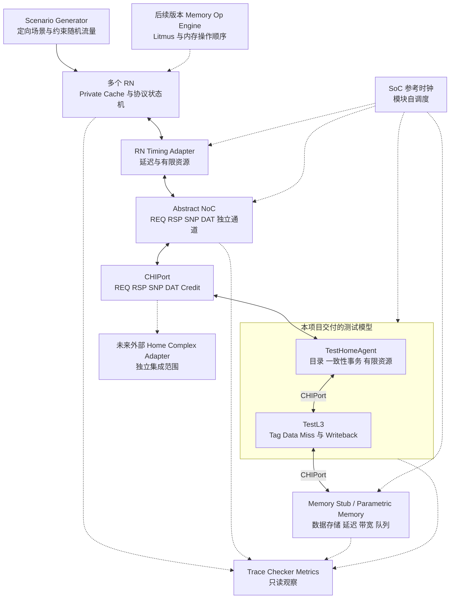

# 芯片 ESL 平台实现计划

日期：2026 年 10 月 29 日

本项目独立开发用于 Cache Coherence 与 Memory Consistency 架构探索的平台和外围组件，并实现测试用 HA 与 L3，使构建、运行和回归均能在本项目内完成。当前范围不获取或集成已有 HN/L3 源码。平台通过可替换模型接口保留未来接入外部模型的能力，先交付 coherence 闭环，再增加 memory ordering 引擎。

变量、函数、CMake 目标、测试与脚本采用小驼峰命名；C++ 类型及其同名文件采用大驼峰；项目自有 C++ 命名空间统一以 `toc` 为根前缀。完整规则见 [编码与命名规范](C:/Explore/TOC_ESL/doc/coding-style.md)。

## 需求依据与当前状态

来源为 [ChatGPT 对话《芯片ESL平台设计》](https://chatgpt.com/c/6a9b7611-9b4c-83e9-b9f4-a74338c8940c)。已读取的对话包含三轮用户输入，最后一条是“先画一版架构图”，未包含其后的架构图答复。

| 类别 | 内容 | 对实现的影响 |
| --- | --- | --- |
| 用户明确目标 | 探索 memory consistency 和 cache coherence，兼顾开发效率、仿真效率、精确性 | 分别定义协议、时序和内存模型的验收标准 |
| 最新范围约束 | 本项目不获取 HN/L3 源码，仅开发平台和组件；可以实现测试用 HA/L3 | 使用自包含的测试模型完成全部平台回归，外部源码不作为依赖 |
| 目标工具链 | 原 CA 模型采用 CMake 和 GCC 12.2 编译运行 | 平台以 CMake/GCC 12.2 为目标，独立组织 CMake target |
| 当前开发机状态 | WSL2 + Debian 12 已就绪，GCC/G++ 12.2.0、CMake/CTest 3.25.1、Ninja 1.11.1 已安装，工具链 CTest 1/1 通过 | 编译环境准备已完成；下一步建立平台主工程与公共接口，详见编译运行环境文档 |
| 测试模型精度已确认 | HA 和 L3 为事务级功能模型，延迟和资源可配置 | 事件驱动，保证声明子集的功能与协议行为，显式模拟排队和资源占用 |
| 对话中的建议 | RN 功能与时序分离、轻量 NoC、参数化 Memory、统一调度、Trace 和 Checker | 作为本计划的建议架构基线 |
| 首阶段设计任务 | 定义平台调度、端口、协议子集、数据和测试模型能力 | 由本项目自行建立契约，不等待既有模型信息 |

协议参考为本地 **ARM IHI 0050 Issue G.b，2025 年 9 月 8 日**规范。本项目仅实现明确声明的测试子集。测试用 Home Agent 简称 HA，承担 home 端的协议协调；其名称和职责不表示复刻外部 HN 的微架构。

## 架构与版本范围



所有数据通路组件通过 `toc::chi::CHIPort` 连接，包括 HA–L3。每个模块按值持有并自行推进自己的 CHIPort，由 SoC 在顶层完成端口连接。每个 CHIPort 固定提供一个 REQ、RSP、SNP、DAT 通道及各自的 link credit；接口契约见 [CHI 公共接口](C:/Explore/TOC_ESL/doc/chi-interface.md)。CHIPort 只负责周期接口信号连接，不设置 buffer 或额外 delay，credit 由连接两侧显式传递。所有模型继承 `toc::common::BaseModule`，持有 SoC 唯一 `EnvCfg` 的只读引用，通过 `work()` 计算组合逻辑，通过 `xfer()` 提交周期状态。

**V0 最小闭环**：1 个脚本 RN、测试 HA/L3、固定延迟传输、最小 Memory Stub、事务 Trace 和生命周期检查。

**V1 平台与组件验证版本**：默认 3 个 RN，数量可配置；1 组测试 HA/L3；RN 私有缓存状态；四通道 NoC；参数化 Memory；定向与随机场景；协议检查、统计和批量参数扫描。测试模型的性能结果用于检查平台行为和抽象参数效应，不能直接解释为真实 HN/L3 的性能。

**V2 Memory Consistency 平台**：在 V1 上加入 Memory Op Engine、真实数据、依赖、屏障、acquire/release 和选定原子操作，并与固定版本的内存模型参考结果对照。

首版范围暂不包括完整 CPU 流水线、操作系统启动、router/flit 级 NoC、DRAM bank 时序、多 HN、异步 CDC、完整 CHI 全特性和复杂 GUI。模块内部子模块支持相对 SoC 参考时钟的整数分频；DVM、stash、持久化等特性按研究需求另立扩展任务。

## 模块职责和精度契约

| 模块 | 实现内容 | 精度与边界 |
| --- | --- | --- |
| ChiCommon/CHIPort | opcode、REQ/RSP/SNP/DAT flit、单通道端口配对和 credit | CA 级直接传输；所有数据通路组件共用，包括 HA–L3 |
| TestHomeAgent | 目录、同 line 序列化、事务表、snoop、响应与 Retry | 支持子集的功能和协议准确，事务延迟和资源占用可配置 |
| TestL3 | 组相联 tag/data、替换、miss、writeback、资源限制 | 独立可测试的缓存后端；不声称等价于外部 L3 |
| SoC Reference Clock | 唯一 EnvCfg、cycle 推进、顶层模块固定阶段顺序 | 时间单调；模块共享同一周期；运行可复现 |
| RN Functional Model | 缓存权限、数据、事务与 snoop 状态机 | 对声明支持的协议子集准确 |
| RN Timing Adapter | 请求和 snoop 延迟、队列、outstanding 限额 | 参数化资源及时序，不实现完整私有缓存流水线 |
| NoC | 路由、各通道服务率、容量、仲裁与背压 | 对选定抽象规则准确，不承诺真实 router 延迟 |
| Memory Endpoint | 下行协议响应、读写数据、完成条件 | 遵守项目声明的下行子集；响应接收与资源释放可追踪 |
| Memory Backend | 存储、读写延迟、带宽、排队 | 功能数据准确；DRAM 细节不在首版精度范围 |
| Scenario Generator | 初始内存、操作序列、触发条件、随机流量 | 能构造竞争、验证预期并保存复现输入 |
| Checker/Trace/Metrics | 不变量、事务链、资源占用和性能 | 独立观察实现结果，不共享 DUT 协议决策逻辑 |
| Memory Op Engine | 程序序、发射、完成、提交、依赖与屏障 | 针对选定 ISA/内存模型子集验收 |

## 平台必须固定的契约

### 运行框架与时间推进

构建基线已确定为 **CMake + GCC 12.2**。首版由 SoC 在 C++ 单线程中持有唯一 `EnvCfg` 并推进参考 cycle；顶层模块每个参考周期执行一次 `work()` 和 `xfer()`，内部子模块按整数 divider/phase 自行调度。当前不依赖外部 HN/L3 内核；将来接入 SystemC 等运行框架时，由专门的驱动适配层处理时间主控关系。

M0 的编译环境准备已完成：在 WSL2 的 Debian 12 中，以普通用户成功配置、编译并运行独立 C++17 检查程序。ChiCommon、CHIPort 和对应 CTest 已建立；工具链与接口测试通过不代表平台模型或协议功能已实现。

本地环境采用 WSL2 中的 Debian 12 Bookworm，加 GCC/G++ 12.2、CMake 和 Ninja。Debian Bookworm 官方提供 [G++ 12.2 软件包](https://packages.debian.org/en/bookworm/amd64/g%2B%2B-12)；发行版需明确固定为 Bookworm，不能假定 WSL 中未指定版本的 Debian 就是 Debian 12。固定版本镜像、安装脚本、实际工具版本和验收用法见 [编译运行环境](C:/Explore/TOC_ESL/doc/build-environment.md)。

平台与测试组件采用 C++，以 C++17 为起点；脚本负责场景批量运行与结果分析。依赖版本与编译选项在 M0 固定，验证环境使用 WSL2 中的 GCC 12.2，Windows 工作区通过 `/mnt/c/Explore/TOC_ESL` 访问。

模型代码集中在 `model`，设置 `eslCommon`、`eslRn`、`eslNoc`、`eslMemory`、`eslTestHa`、`eslTestL3` 等 target；仿真运行代码集中在 `top`，由 `eslRuntime` 提供调度、组装、场景驱动、Checker、Trace 和统计，`eslSim` 提供运行入口。公共服务接口位于 `model/Common`，模型不依赖 top 的具体实现。默认构建只依赖本项目和固定的公开依赖，不查找外部模型目录、库或头文件。外部模型适配将来作为可选 target 添加，涉及二进制链接时另行约定 ABI。

将 smoke、协议定向和集成回归注册到 CTest，并按类别标记；批量扫描由脚本驱动同一可执行文件。配置阶段检查编译器版本，运行记录保存完整 GCC 版本、CMake 配置及构建类型。提供 Debug 和 Release 两种构建，配置中显式指定测试 backend。

平台的周期契约组织为：

1. 投递当前时刻到期的输入和资源释放事件。
2. 依据明确的握手规则，决定当周期被接受的输入。
3. 执行当前事件，并对声明需要周期推进的模型执行一次 evaluate/commit。
4. 采集已完成握手的输出，安排后续到达事件。
5. 执行周期末检查，更新统计与进展信息。

事件按 `(cycle, phase, sequence)` 稳定排序；同周期事件不得回写已经结束的阶段。首版跨组件边界采用至少一周期延迟，拒绝隐含的零延迟递归调用。模型驱动接口显式报告是否需要 tick 和下一唤醒时刻，所有后台状态推进都由统一调度器管理。

首先保留“每周期推进”的参考模式。空闲跳时优化只有在模型能声明 **无需逐周期演进**，并提供下一内部唤醒时间或保证仅由外部输入唤醒时才开启；在途流水线、内部计时器、维护操作和周期相关状态都需要计入。

### 消息与接口

统一消息容器包含 `channel`、相应类型的协议 payload 和仿真元数据。按通道区分字段有效性，避免假设 RSP/DAT 都含有效地址；诊断地址通过事务映射获得。

| 接口或数据 | 必须约定的语义 |
| --- | --- |
| 端口接收 | `tryAccept` 成功才转移消息所有权；失败时发送者保留消息，等待可用事件 |
| 端口发送 | 输出停顿时内容保持稳定；有界缓冲、释放时刻和 credit 返回规则明确 |
| 协议字段 | 按子集保留 SrcID、TgtID、TxnID、DBID、Opcode、Resp、Order、ExpCompAck 等 |
| 数据传输 | line size、数据宽度、DataID、分拍数量、byte enable、字节序及错误字段明确 |
| 事务追踪 | `GlobalTxnID` 仅作追踪；协议 TxnID、DBID 仍按各自作用域分配和复用 |
| 关联关系 | 区分逻辑操作、重试 attempt、HA 子事务和 snoop 子事务，记录 parent 关系 |
| 可观测性 | 只读快照或事件接口；可读不到的内部指标明确标记，不能推测为零 |

按照规范 B2.4 和 B2.6.3，不能把“收到了数据”等同于所有事务资源均可释放，也不能用一个全局 ID 替代协议 ID 的流转。完成条件必须逐事务列出，包括适用的 CompAck、分拍数据、分离响应和写数据过程。

### 首版协议子集

在 M0 创建能力矩阵，每项包含“测试 HA 支持、测试 L3 支持、RN 支持、Memory 支持、完成条件、对应场景”。只启用所有参与端点均支持的事务。该矩阵作为项目自己的支持声明，未来外部模型可提供不同的能力描述。

- 优先覆盖 ReadShared、ReadUnique、Evict、WriteBackFull，以及由这些请求实际触发的 snoop、RSP 和 DAT 流程。
- 将 CleanUnique、MakeUnique 列为下一批候选；尤其不能在没有处理空数据所有权的情况下直接加入 MakeUnique。
- RN 状态以 CHI 的 I、UC、UD、SC、SD 等命名；UCE、UDP 按子集需要实现。每条缓存行另设在途事务和等待条件，处理 snoop 与 miss、upgrade、evict/writeback 的重叠。
- 首版采用经 HA 返回数据的简单流程，暂不实现 DCT/DMT、forwarding snoop 和分离响应；配置与能力协商禁止启用这些特性。后续接入需要这些流程的外部模型时，先补齐端点支持。
- 测试 HA 支持可控的 RetryAck/PCrdGrant 压力模式，覆盖 credit 早于 RetryAck 到达、按类型匹配和重发。协议 P-Credit 与 NoC 的容量或链路 credit 分别记账。
- 对未支持的 opcode、状态和配置启动时报错；运行中收到未声明支持的合法变体，输出完整上下文并失败。

状态与流程依据本地规范 B4.1、B4.6、B4.7、B4.8；重试依据 B2.9。首版支持范围由项目能力矩阵固定。

### 数据与初始状态

V0 起保留小规模真实数据通路，区分 RN 私有脏数据、L3 数据和 Memory 数据；store 不应绕过模型提前更新全局 Memory。首版测试地址空间保持较小，便于验证数据所有权和逐字节结果。

测试 HA/L3 从 V0 即传递真实数据，为平台检查和后续 V2 保留完整数据通路。V1 可增加 metadata 模式用于资源和性能探索，但不得用它得出 load 值、atomic 结果或 Memory Consistency 结论。

场景初始缓存状态优先通过正常事务预热得到。直接注入 RN 状态只能通过能同步设置 RN、HA directory、L3 和 Memory 的一致性初始化接口，禁止只把 RN0 设置成 Dirty 却不更新其他参与者。

## 测试用 HA 和 L3 的实现范围

`TestHomeAgent` 与 `TestL3` 是本项目正式维护的测试组件，承担端到端回归和压力场景的协议对端。它们采用事件驱动的事务状态机，以可配置的等待时间和有限资源表达时序；无需实现外部 HN/L3 的逐周期流水线。

| 组件 | 必须实现 | 可配置参数 | 简化边界 |
| --- | --- | --- | --- |
| HA Directory | owner、sharers、脏责任、在途访问关联 | 测试地址空间和节点数 | 首版独立于 L3 tag，以稀疏表保存，不研究目录容量淘汰 |
| HA Transaction Engine | 请求解码、同 line 序列化、snoop 收集、数据来源选择、返回与确认 | 事务表项、snoop slot、输入/输出队列深度、处理延迟 | 同 line 默认严格序列化，不实现激进 bypass |
| HA Flow Control | 有限接收资源、背压、RetryAck、P-Credit 分配与回收 | 资源阈值、credit 类型、响应延迟 | 首版采用确定性公平策略，复杂 QoS 后置 |
| L3 Tag/Data | 组相联查询、真实数据、替换和脏行标记 | 容量、路数、bank 数、tag/data 延迟 | 首版采用简单确定性替换策略，不复制外部模型算法 |
| L3 Miss/Writeback | miss 请求与回填、独立脏行写回、完成反馈 | MSHR 数、writeback 队列深度、各 bank 服务间隔 | 同 line 合并等优化后置；首个闭环可仅有一个 outstanding miss |

HA 的单条事务至少跟踪“接收、查找、等待 snoop、等待 Memory、发送数据/完成、等待必要确认、释放”的适用阶段，并保存 pending snoop 集合与数据就绪状态。不同地址可并发，同地址按明确规则排队。输出因背压未被接受时，事务和待发送数据持续保留。

L3 命中不自动代表其数据可作为最新数据返回：HA 必须依据 owner 和脏责任判断是否需要向 RN 获取数据。首版将 HA directory 与 L3 数据驻留分离，L3 替换不能直接删除仍有 RN 副本的目录记录；带回的脏数据、L3 回填和 Memory 写回均按统一事务规则更新。

资源采用预约与释放事件建模。每个操作记录等待资源、获得资源、开始服务、完成服务和输出被接受的时刻；配置延迟从明确的服务起点计算。仅给每个请求增加固定延迟不足以模拟竞争，有限 MSHR、bank 服务间隔和输出缓冲都必须实际约束吞吐。

资源参数要求为正且配置可执行；无效组合在启动时失败。模型实例自身持有全部状态，复位后清空事件、在途事务和统计，避免不同场景通过全局变量互相影响。

测试模型与 Checker 不共享协议状态转换实现。测试 HA/L3 先用脚本端点和独立期望值验证，再与 RN 联调；L3 的无共享读写场景可对照简单内存模型。协议场景使用人工确定的步骤与数据断言，并注入非法响应检查 Checker 的检错能力，降低多个自研组件出现同向错误的风险。

### 可替换模型边界

平台与组件只通过公共 `CHIPort` 交换 CHI flit，HA 与 L3 也遵守该边界。平台不得访问模型内部目录或 C++ 私有类型。未来外部模型通过 CHIPort adapter 接入；能力查询、构造方式和只读观察契约在后续阶段补充。

## 分阶段实施

以下为单名熟悉 C++ 和一致性协议的开发者的代码工作量估算，包含事务级测试 HA/L3 的实现和测试，不依赖外部模型维护者。编译环境安装、下载和系统配置所需时间另计。范围为上述有限协议子集，不含完整 CHI、生产 HN/L3 适配或硬件精度校准；M0 完成后根据细化的状态机重新估算。

| 阶段 | 主要任务与交付物 | 验收条件 | 依赖 | 估算工作日 |
| --- | --- | --- | --- | --- |
| M0 编译环境与工程骨架 | 准备编译环境；独立 CMake/GCC 12.2 构建；公共消息、端口、时间与 backend 契约；协议子集；CTest | 工具版本确认，最小 C++ 程序可运行；平台无需外部模型即可构建并通过接口测试 | 无外部模型依赖；构建验收需工具链就绪 | 代码 2–3，环境准备另计 |
| M1 最小闭环 | 调度、脚本 RN、测试 HA 的单 RN 读流程、测试 L3 hit/miss、Memory Stub、Trace 与事务检查 | 完成读 miss、再次命中、必要确认和资源释放；同 seed 可重放 | M0 | 7–10 |
| M2 RN 与多节点一致性 | RN 稳定态与瞬态；HA directory/snoop/owner 管理；L3 真实数据及写回；3 RN；场景 DSL | 共享读、写权限、脏数据干预、失效、写回和驱逐通过独立与联调测试 | M1 | 10–14 |
| M3 竞争与协议压力 | 同 line 交错、有限 HA 事务表与 snoop 资源、L3 MSHR/WB、Retry、检查器扩展 | 队列/ID/credit 守恒；支持子集的事务均能收敛；失败可复现并定位 | M2 | 6–9 |
| M4 参数化传输与内存 | 四通道服务率、队列、仲裁、延迟；Memory 带宽、容量和读写排队 | 吞吐与延迟符合所配置的服务模型；下游阻塞可传播且恢复后排空 | M3 | 5–7 |
| M5 探索和效率 | 参数扫描、报告、热点分析、安全跳时、关闭详细 trace 的快速模式 | 导出参数与性能曲线；优化前后功能结果与约定时间戳一致 | M4 | 4–6 |
| M6 内存模型 | Memory Op Engine；SC 基准；目标模型子集；Litmus；参考结果对照 | 无已观测 forbidden 结果；已选择的关键 allowed 结果有覆盖；失败带完整执行证据 | M5 及数据通路 | 15–25 |

M1–M4 是 V1 的主要实现链；M5 使平台具备稳定的批量探索能力。含 M0 至 M5 约 **34–49 个工作日**；M6 额外约 **15–25 个工作日**。这些是初始工作量区间，不是已确认交付日期。

每阶段结束保留可运行基线。调度、协议和性能优化分别提交，避免在同一次修改中同时改变事务语义和时间推进。

### M1 至 M3 的优先实现顺序

1. 建立独立 CMake 工程、公共契约与 CTest，验证端口背压和复位语义。
2. 实现统一时间、消息容器、协议 ID 分配器与 Trace；用脚本端点验证调度和消息生命周期。
3. 实现 Memory 后端、测试 L3 的单请求 hit/miss，以及测试 HA 的单 RN 读流程，完成第一条 read miss。
4. 分别验证 RN cache 与 HA directory/snoop 状态机，再将完整系统从 1 RN 扩展到 3 RN。
5. 加入写操作、脏数据转移与 writeback；核对各参与者最终状态和数据。
6. 加入有限资源、多个 outstanding 和 Retry，逐项打开随机化。

M1 验收使用本项目的测试 HA/L3。外部模型源码、二进制或既有 trace 均不是验收前置条件。

## 场景和验证计划

Scenario DSL 至少支持初始内存值、RN 标识、操作类型、地址/数据、绝对 cycle、前序操作完成触发、随机 seed 和结果断言。协议流量场景与程序级 memory-op 场景分开表示；Barrier 不应被随意翻译成一个虚构的 CHI 事务。

| 场景组 | 重点验证 | 引入阶段 |
| --- | --- | --- |
| 单 RN read miss 与重复访问 | 下行读取、数据返回、缓存命中路径、完整确认 | M1 |
| 同地址多读者 | 共享权限、数据一致、directory 维护 | M2 |
| Unique 获取与 owner 转移 | 其他副本失效、写权限唯一、数据最新 | M2 |
| Dirty owner 被读取或失效 | snoop 数据来源、脏责任转移、Memory 可保持旧值 | M2 |
| Evict 与 WriteBack | 干净/脏驱逐、DBID 与数据、line 释放 | M2 |
| 同 line 并发 ReadShared/ReadUnique/WriteBack | 瞬态、序列化、snoop 与本地请求竞争 | M3 |
| HA entry 或 RN outstanding 耗尽 | 背压、Retry、ID 回收、无重复完成 | M3 |
| Retry 与 PCrdGrant 重排 | credit 类型和目的节点匹配、重发、取消后的归还 | M3 |
| DAT/RSP 独立拥塞 | 反馈至 HA 占用、接收端缓冲、恢复后的进展 | M4 |
| L3 bank 和 miss/writeback 压力 | 配置的服务间隔、有限资源和竞争行为 | M3–M4 |
| backend 契约测试 | 更换模型构造方式不改变平台端口、复位与能力检查 | M0 起 |
| 不同延迟和小队列随机交错 | 生命周期、守恒、可重复性和覆盖 | M3 起 |
| SB/LB/MP/IRIW 等 Litmus 及屏障变体 | 目标内存模型允许/禁止的结果 | M6 |

检查器需要区分稳定态与协议在途态：

- **权限与数据**：检查协议允许的独占写权限、脏责任和数据来源。不能把传输中的数据副本简单当成多个独立 dirty owner。
- **Directory**：测试 HA 声明自身的 sharer 维护策略。存在 silent eviction 时不能断言每个 directory sharer 位都对应当前有效副本；应检查不漏掉需要探测的节点及合法保守项。
- **生命周期**：检查响应匹配、数据拍完整性、所需确认、ID 的合法释放和无重复完成。
- **资源守恒**：检查缓冲、链路容量、协议 credit 的分配与归还；每种资源定义独立计数口径。
- **进展**：区分长延迟、等待外部事件、饥饿与可能死锁。超时保存在途事务、等待关系、队列和最近事件；超时本身是诊断线索，不是形式化死锁证明。

回归门槛建议先采用“全部定向场景 + 固定的随机 seed 集合”，随覆盖增量扩展。完成一次场景后应排空预期事务，核对资源回收；永久保持缓存驻留不等于资源泄漏。通过负向注入验证 Checker 确实能发现重复响应、非法 ID 或缺失确认。

当前精度验收针对声明的事务功能、协议流程和参数化时序契约。时序用可手工计算的带宽、排队和延迟场景校验，事件跳时与逐 cycle 扫描到期事件的参考调度模式比较结果；测试 HA/L3 本身无需逐 cycle 调用。接口驱动能力另用小型测试组件验证。

测试 HA/L3 不是经过独立验证的硬件 golden model，平台端到端通过不能证明真实 HN/L3 正确或周期精确。将来若开展外部模型适配与硬件校准，再另建其接入回归和 golden trace 对照任务。

## Memory Consistency 的独立实施范围

M6 先选定一个目标模型及版本。建议先用顺序一致性 SC 检查端到端程序语义，再加入目标 ISA 的已界定子集；原对话没有明确选择 ARM、TSO 或自定义模型，不能把示例配置当作既定需求。

Memory Op Engine 区分 issue、执行完成、架构提交，以及模型所需的可见性事件；支持 store buffer、load queue、同地址转发、数据/地址/控制依赖和屏障条件。协议完成点与程序级可见性之间建立显式映射，不能仅凭 CHI Comp 或 load/store 重排开关判定全部 ISA 规则。

建议使用 [herdtools7](https://github.com/herd/herdtools7) 产生固定 `.cat` 模型及 Litmus 的参考结果。其 [官方教程](https://diy.inria.fr/tuto/mem/index.html) 解释了程序序、reads-from、coherence order 和模型过滤；据此记录必要的操作关系和 witness，而不仅统计最终寄存器值。

验收分别报告：

1. **安全性检查**：已观测执行不能包含参考模型禁止的结果；发现差异时保存具体执行证据。
2. **探索覆盖**：选定的关键允许结果是否已被场景与调度探索命中；未命中需要区分采样不足与实现更强的顺序约束。
3. **验证范围**：随机试验未见错误不等于形式化证明；需要穷举的小型场景单独声明状态、调度和深度边界。

ISA 允许但实现没有产生的结果不自动构成错误，完整匹配全部允许结果也不作为普通微架构实现的强制要求。若目标是完整探索某种内存模型，则应把允许结果覆盖单独作为研究能力要求。

## 可观测性和仿真效率

Trace 记录 cycle、phase、节点、通道、opcode、协议 ID、GlobalTxnID、父事务、诊断地址、状态变化和 stall 原因。诊断地址来自已校验的关联关系。详细 trace 支持按地址/事务筛选，失败保留有限长度环形缓冲。

每次运行在 `top/run/<batch-id>/<run-id>` 保存配置、场景、seed、模型版本、构建信息、完成状态与结果文件。首版建议输出 `run.json`、`events.jsonl`、`metrics.json`，批次汇总为 `summary.csv`；测例原始输入保存在 `benchmark`。

性能统计优先包括：事务吞吐、P50/P90/P99 延迟、HA entry/snoop slot 占用、L3 hit/miss/MSHR/bank conflict、各通道发送字节与阻塞时间、Memory 队列与读写服务率。报告必须标记 backend 为测试模型及其参数；没有真实 CPU 指令执行计数时，不报告 IPC 或 MPKI。

优化顺序为减少空闲 tick、减少事件与对象分配、降低数据复制、控制 trace 开销，最后再考虑更复杂的调度优化。统计时间加权队列占用时，跳过的周期也必须计入。

基准至少包含空闲稀疏流量、连续 miss、同 line 争用、DAT 拥塞四类。分别记录 wall time、simulated cycles/s、completed transactions/s 和峰值内存；先建立基线，再根据热点设定优化目标，不预先承诺加速倍数。

## 建议工程结构与首批任务

工程根目录下统一划分为 `model`、`top`、`benchmark`、`doc`、`scrpits`。完整目录、职责边界和构建方式见 [目录规划](C:/Explore/TOC_ESL/doc/directory-layout.md)。默认构建与回归完全使用本项目的测试 HA/L3。

```text
model/                 模型代码：Common、ChiCommon、SoC、RN、HA、L3、NoC、Memory、MemoryEngine
top/                   仿真工程入口及全部运行支撑
  CMakeLists.txt       引入模型库，构建仿真程序与测试
  cmake/               工具链、依赖与编译选项
  src/                 main、调度、系统组装、workload、Checker、Trace
  config/              平台参数、批次、扫描配置及格式约束
  tests/               自动化测试程序与夹具
  build/               构建产物
  run/                 配置快照、日志、Trace、统计与报告
benchmark/             smoke、coherence、stress、negative、performance、litmus
doc/                   计划、架构、接口和参考规范
scrpits/               构建、运行、回归、扫描、重放和结果分析脚本
```

目录骨架已沿用当前小写 `model`、`top` 命名建立，保留已有 `model/SoC`。每个模型目录均包含 `include`、`lib`、`src`；代码、CMake 文件和脚本将在相应阶段实现。

| 首批任务 | 完成标志 |
| --- | --- |
| 准备本地或明确指定的外部编译环境 | GCC/G++ 12.2、CMake/CTest 与构建执行程序可用，最小 C++ 程序编译运行成功 |
| 建立独立 CMake 工程和测试入口 | 使用 GCC 12.2 构建空平台并通过 CTest，无外部模型依赖 |
| 定义协议版本和能力子集 | 形成事务、snoop、响应、数据与完成条件矩阵 |
| 固定时间和端口契约 | 明确握手、阻塞、复位、输出时刻、ID 和模型能力规则 |
| 实现测试 L3 与 Memory 的单请求读写 | hit/miss、回填和数据断言通过独立测试 |
| 实现测试 HA 的单 RN 事务 | read miss 的数据及必要确认完整返回，事务资源释放 |
| 组装首个闭环场景 | 脚本 RN、HA、L3、Memory、Trace 与 Checker 一起运行并可重放 |

当前范围与测试模型精度已明确，可以从 M0 开始推进。后续仅在 M6 前选定目标 ISA/内存模型子集；未来外部 HN/L3 的端口和运行内核信息由独立集成任务处理，不阻塞本项目的平台和组件开发。

本地协议依据：[AMBA CHI Issue G.b](C:/Explore/TOC_ESL/IHI0050G_b_amba_chi_architecture_spec.pdf)，重点章节为 B2.4、B2.6.3、B2.9、B4.1 与 B4.6；具体事务实现还需逐项核对 B4.7 和 B4.8 的状态转换表。
