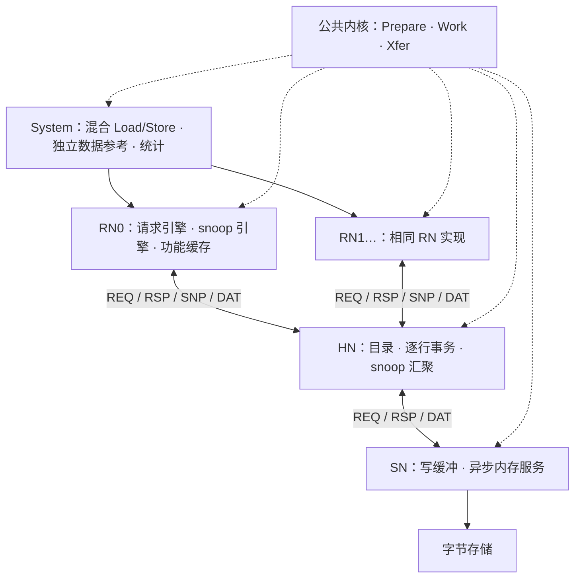

# 基于 CHI 的 ESL 仿真平台总体架构

更新日期：2026-11-13。当前实现主线为 `model/chi_vip` 的 RN/HN/SN，公共平台位于 `foundation/` 和 `kernel/`，公共 CHI 接口位于 `model/chi_interface/`。

## 当前可执行系统

`esl_sim` 通过 `esl::chi_vip::System` 装配多个 RN、一个 HN 和一个 SN，默认两个 RN。所有节点通过真实 CHI 点到点端口通信，支持一致性读写、缓存维护、snoop、重试和资源背压。旧的只读 CHI→AXI 系统及其专用模型不再作为构建或演进入口。

当前平台采用 C++17、单线程、单时钟、整数 ps 时间和启动复位。协议核心通过事件及就绪队列推进，端口适配层每周期执行 Work/Xfer。跨节点消息最早下一周期可见；实际发送、请求完成和资源回收分别建模，不能由一次 Send 成功替代。

## 职责与依赖

| 部分 | 当前职责 | 实现位置 |
| --- | --- | --- |
| 公共服务 | 时间、TOML 配置、日志、Trace | `foundation/` |
| 仿真内核 | 生命周期、定时事件、Work/Xfer、终止诊断 | `kernel/` |
| CHI 接口 | 标准 flit、独立四通道 FIFO、link credit、传输延迟 | `model/chi_interface/` |
| RN-F | 前端 Load/Store、精确 Submit、缓存、替换、请求与 snoop 双引擎 | `model/chi_vip/rn/` |
| HN-F | 一致性序列化、目录、逐行受理顺序、上/下游关联和数据汇聚 | `model/chi_vip/hn/` |
| SN-F | 合法下游请求、写 DBID、异步内存、读写完成 | `model/chi_vip/sn/` |
| 适配层 | 核心事件与真实端口互换、实际发送确认、ModelBase 封装 | `model/chi_vip/include/`、`src/` |
| 应用系统 | 拓扑装配、混合负载、数据参考、清洁排空、结果输出 | `model/chi_vip/system/` |

`esl_chi_vip` 核心仅依赖标准库和 CHI 载荷定义，不依赖日志、配置或 ModelBase。`esl_chi_vip_transport` 连接核心与 `esl_chi`；`esl_chi_vip_adapter` 才依赖公共平台；`esl_chi_vip_system` 负责应用装配。这些边界允许在独立测试中使用同一协议核心，也允许后续替换运输或内存时序模型。

节点不得直接调用对端业务逻辑或读取对端缓存与事务表。系统初始化和最终检查可使用内存管理接口，正常事务仍必须经过 CHI 和异步服务。

## 协议与数据正确性

依据仓库 [CHI Issue G.b 规范](IHI0050G_b_amba_chi_architecture_spec.pdf)，当前 `GbCore` 支持 20 种主动请求、8 种 snoop、七种 RN 缓存状态以及对应响应、DAT、DBID、CompAck、重试和排序流程。数据为 64B 行、256-bit DAT，默认 Normal memory、Non-secure。

HN 无 LLC，仅保存事务所需临时数据。目录记录协议可见权限，不能知道 RN 的静默 UC→UD。需要确认最新数据时查询潜在持有者；接收脏责任后，先安全写入 SN，再授予清洁数据或权限。ReadOnce 等不转移责任的快照流程允许 RN 继续保留脏数据。部分数据按字节掩码合并。

同一行按 HN 受理顺序推进，不同行可并发。已承诺事务的响应、snoop 和完整数据接收资源不得被新请求耗尽。Link credit 属于端口，Protocol credit 属于事务核心；重试逻辑不把 credit 绑定到单个 TxnID。

应用维护独立字节参考，按可确定的同行因果关系检查 Load。最终通过 WriteBack/Evict 清理触及缓存行，完整排空后再比较 SN；系统空闲本身不代表缓存没有脏数据。

协议支持矩阵、规则编号及测试索引见 [VIP 文档](../model/chi_vip/README.md)和[三组件系统说明](../model/chi_vip/SYSTEM.md)。合法但未启用功能报告 UnsupportedFeature，协议违规报告 ProtocolViolation，不默认为成功。

## 性能解释边界

当前是指定事务集合的协议功能基线，保留有限资源、流控、服务延迟、同地址竞争和确定性。HN 的清洁策略保守，SN 使用固定延迟字节内存；结果可比较当前实现中的资源与流控变化，尚不能直接对应目标芯片的 HN/LLC 或 DRAM 时序。

尚未实现 LLC、Fabric 路由、多 HN 地址映射、DRAM bank/row 调度、完整 CPU 执行或操作系统启动。DMT/DCT/DWT、Atomic、DVM、Stash 等未启用能力以支持矩阵为准。当前测试不代表完整 G.b 或引脚级认证。

所有性能报告应保留模型版本、配置、种子、负载与统计窗口。事务内活动可能重叠，分析时不能直接相加各阶段延迟；含启动和最终清洁开销的吞吐不应称为稳态吞吐。

## 后续演进分层

长期架构保留五个职责层次。下表中的扩展是后续工作，不表示当前代码已具备相应服务。

| 层次 | 当前基础 | 后续扩展 |
| --- | --- | --- |
| 架构探索与性能分析 | JSON、Trace 和基础流量统计 | 延迟分布、阻塞归因、方案对比、DSE |
| 仿真管理 | 启动配置、运行控制、结果文件 | 多实验任务、资源配额、归档和校准 profile |
| ESL 仿真内核 | 确定性单线程 Work/Xfer、定时事件 | 多时钟域、空闲跳时、分区和线程同步 |
| SoC 系统建模 | 多 RN、单 HN/SN、点到点 CHI | Fabric、多 HN、LLC、内存时序和仲裁 |
| Benchmark 与工作负载 | 混合 Load/Store、定向与随机测试 | 依赖 Trace、注入模型、组合场景及预热/测量阶段 |

分析层决定运行哪些实验，管理层安排执行，内核只负责交付时间和调度。HN 事务受理、LLC 端口仲裁、Fabric 路由和 QoS 属于硬件模型，不能转移到通用内核。

多实例并行属于实验管理，单实例多线程属于内核。后续引入并行前保留单线程参考路径，比较完整结果和关键轨迹；线程资源需要统一配额，避免两级并行过度争用。

HN 与未来 LLC 逻辑分离。HN 处理一致性和事务资源，LLC 处理缓存阵列、回填、替换和端口竞争；接口需要显式请求、响应与接收能力，不能通过同步调用返回最终结果绕过时序。Directory、Snoop Filter 与 LLC Tag 的职责也应分别定义。

容量、延迟、带宽和阈值适合配置参数；仲裁、替换和地址映射适合策略；流水线或目录组织的大变化适合模型变体。现有接口中的能力声明、资源生命周期、发送确认和规则测试应持续复用。

## 校准与验收原则

1. 保持配置、执行、结果三个契约明确：参数单位及约束、事件和可见性、统计边界与版本。
2. 先验证协议功能及资源排空，再评估性能时序；每次扩展关联到规范规则与独立预期。
3. 通过无竞争、单资源压力、混合负载逐级校准，参考来源可为 RTL、已有模型或芯片测量。
4. 对齐输入、预热、测量窗口和结束条件，拟合数据与验证数据分开保存。
5. 校准结果以 profile 记录来源、版本和适用范围，未验证前不声明精度指标。

当前运行和验证入口见[构建与运行](build_and_run.md)，周期约束见[时钟设计](clock_design.md)，三个组件的实现细节见各自架构说明。
