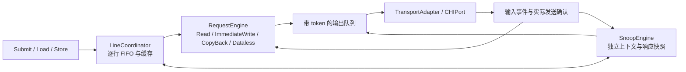

# CHI G.b VIP 与 RN-F 接口

本目录是当前平台的 CHI 协议主线，包含可独立构建的 C++17 RN-F、HN-F、SN-F，命名空间为 `esl::chi_vip`。本文件详细说明 RN 的请求引擎、Snoop 引擎、行协调器、功能缓存、规则目录、事件调度、CHIPort 适配及 ModelBase 封装。RN 核心位于 `rn/include` 和 `rn/src`；主动 HN、SN 分别位于 `hn/`、`sn/`，连接和系统验证见 [三组件系统说明](SYSTEM.md)。`system/` 装配三个组件，提供 `esl_sim` 的混合读写负载及结果检查。

实现架构分别见 [RN](rn/ARCHITECTURE.md)、[HN](hn/ARCHITECTURE.md)、[SN](sn/ARCHITECTURE.md)。

依据仓库 [CHI G.b 规范](../../doc/IHI0050G_b_amba_chi_architecture_spec.pdf) 的 B2、B4、B9、B13 和 C3。验收范围是 **G.b 指定事务集合的 RN 协议层实现**，不代表完整 G.b、引脚级或性能时序精度认证。

## 构建与测试

独立构建 RN/HN/SN、CHIPort 运输层和测试，不需要日志库、TOML 或 ModelBase：

```sh
cmake -S model/chi_vip -B /tmp/esl-vip-rn -DCMAKE_BUILD_TYPE=Debug
cmake --build /tmp/esl-vip-rn -j2
ctest --test-dir /tmp/esl-vip-rn --output-on-failure
```

从仓库根目录构建会自动包含三个组件、平台适配、应用系统和测试。构建目标如下：

| 目标 | 依赖及用途 |
| --- | --- |
| `esl_chi_vip` | 标准库和 CHI flit 定义；独立核心 |
| `esl_chi_vip_transport` | 核心及 `esl_chi`；CHIPort 适配 |
| `esl_chi_vip_adapter` | 运输层及 `esl`；全工程构建提供 RNModel、HNModel、SNModel |
| `esl_chi_vip_system` | 平台适配及应用装配；提供混合负载、独立字节参考和结果输出 |
| `esl_chi_vip_tests` | 独立可编排 HN 替身及 9 组核心/运输层测试 |
| `esl_chi_vip_platform_tests` | RNModel 与 ModelBase 生命周期及遍历确定性测试 |

全工程同时验证公共平台、CHI 端口、RN/HN/SN 和应用系统；独立构建只包含协议核心与运输层测试。使用 `-Wall -Wextra -Wpedantic -Werror`。格式检查使用 clang-format 18 和根目录 `format-check` 目标。应用运行命令及配置见[构建与运行](../../doc/build_and_run.md)。

ASan/UBSan 构建示例（依赖及 Python 3.10 路径按本机调整）：

```sh
cmake -S . -B /tmp/esl-vip-full-sanitize \
  -DESL_DEPS_DIR=/tmp/esl-deps/sources \
  -DPython3_EXECUTABLE=/usr/local/bin/python3.10 \
  -DCMAKE_BUILD_TYPE=Debug -DESL_SANITIZERS=ON \
  -DCMAKE_CXX_FLAGS=-fno-pie -DCMAKE_EXE_LINKER_FLAGS=-no-pie
cmake --build /tmp/esl-vip-full-sanitize -j2
ASAN_OPTIONS=detect_leaks=0:handle_segv=0 UBSAN_OPTIONS=halt_on_error=1 \
  ctest --test-dir /tmp/esl-vip-full-sanitize --output-on-failure
```

该 WSL 检查组合启用地址和未定义行为检测，关闭 LeakSanitizer；不能把此结果表述为泄漏检测通过。

## 最小接入

使用 `TransportAdapter` 时，由适配器推进 RN 端口及核心。不要再另外调用同一个 RN 端口的 Work/Xfer。

```cpp
#include "rn.hpp"
#include "transport_adapter.hpp"

namespace vip = esl::chi_vip;
vip::RNConfig config;
config.node_id = 0;
config.home_id = 1;
vip::RN rn(config);
esl::CHIPort rn_port("rn.chi"), hn_port("test_hn.chi");
rn_port.Connect(hn_port);
vip::TransportAdapter adapter(rn, rn_port);

const auto operation = rn.Load(0x100, 8);
// accepted=false 表示背压；稍后再次提交，不会消耗句柄。
for (std::uint64_t cycle = 0; cycle < 1000; ++cycle) {
    adapter.Work(cycle);
    hn_port.Work();
    // HN 的 Work：从 hn_port 接收 REQ/RSP/DAT，向其发送 RSP/SNP/DAT。
    // 同一周期所有组件完成 Work 后，才开始任何组件的 Xfer。
    adapter.Xfer();
    hn_port.Xfer();
    vip::Completion completion;
    while (rn.PollCompletion(completion)) {
        // 按 completion.handle 对应 operation.handle，检查 error/valid/data。
    }
    if (adapter.IsIdle() && hn_port.IsIdle()) break;
}
```

上面的循环展示接线及阶段顺序，HN 部分由调用方提供。可直接运行的替身和完整循环在 [核心测试工具](../../tests/chi_vip_test_support.hpp)、[CHIPort 测试](../../tests/chi_vip_test.cpp) 和 [ModelBase 集成测试](../../tests/chi_vip_platform_test.cpp)。测试预期使用独立表格和字节组包，不调用 RN 规则函数推导预期响应。

已有 ESL 系统可以构造 `RNModel(id, path, context, config, observer)`，通过 `Port()` 连接 HN，通过 `Core()` 访问 RN 接口，再注册到 `SimKernel`。启动复位时核心必须空闲；激励通过内核 Prepare 阶段的定时事件提交，或在所有组件 Work 之前提交。不要从另一个模型的 Work 中按遍历顺序直接修改 RN。

绕过 CHIPort 使用核心时，每周期的调用顺序为：

1. 在 `BeginCycle` 前提交操作及 `OnEvent` 输入。
2. `BeginCycle(cycle)` 处理输入、就绪事务和到期诊断。
3. `TakeActions()` 取走待发送动作；重复调用不会重复返回动作。
4. 运输层尝试发送并保存 token，`Commit()` 发布缓存视图、完成结果和观察记录。
5. 下一周期前分别提交 `Event::Accepted(token)` 和 `Event::Sent(token, actual_cycle)`。TX 堵塞时保留动作，不能把入队成功当成发送成功。

核心支持一个未提交周期，不提供推测执行回滚。协议错误、接口误用或诊断超时会抛出 `VIPError`，用于终止并定位当前测试；不会自动释放事务或伪造成功完成。

## 两层访存入口

`Load(address, size)` 的 size 是本地访问字节数，可为 1..64，但不能跨缓存行。命中有效字节时直接完成；缺失时发 ReadShared。UDP 中缺失的字节需要先 WriteBackPtl，再重新取整行。

`Store(address, line_data, mask)` 的 data 和 mask 都使用 **缓存行内绝对字节位置**。例如更新 `0x103`：地址可为 `0x103`，数据放入 `line_data[3]`，mask 为 `1ULL << 3`。I 状态先 ReadUnique；SC/SD 先 CleanUnique；已有唯一权限时本地写入。UCE/UDP 支持部分有效字节，完整后成为 UD。本地 Store 清除被覆盖字节的错误标记并清除 CAH，向 Observer 发出 `store` 记录。

`Submit(TxnRequest)` 精确指定线上事务，不会偷偷更换 opcode 或为非法起始状态先执行清理。同行排队后，在实际开始时校验状态，因此依赖前驱结果的非法起始状态可能在 BeginCycle 报错。MakeUnique 必须携带完整替换行，不能仅靠权限响应把未初始化内容标为有效。

`TxnRequest.size` 是 CHI 字节长度，只允许 1/2/4/8/16/32/64；编码由核心生成。Normal 访问窗口为 address 向下对齐到 size；地址低位可指定 critical chunk。所有 Full 写只能是 64B。Ptl 写允许任意合法 BE，包括全零，但仍发送规定拍数。读 CompData 的 BE 不参与有效字节判断。

默认是 Normal、Cacheable、Non-secure、单时钟和启动复位。Normal 请求使用 Order=0 或合法的 Request Order=2。**Endpoint Order=3 必须显式选择 `MemoryType::kDeviceNRnE`**，只支持 ReadNoSnp、WriteNoSnpFull/Ptl；Full Device 写还必须 64B 对齐。Device 访问从 address 开始，到下一个 size 边界结束。这一约束来自 B2.12、B4.14，避免生成 Normal + Endpoint Order 的非法字段组合。自动 Load/Store 始终使用 Normal。

## 支持矩阵

以下初始状态是精确 Submit 的本地起始状态。Evict/CleanInvalid/MakeInvalid 的可用非 I 状态会在发送请求前按规范转为 I。状态集合包含规范允许且本实现支持的起始状态，不要求调用者选择特定的“预期状态”。

| opcode | 初始状态 | 响应与主要完成条件 | 规范 |
| --- | --- | --- | --- |
| ReadNoSnp | I | CompData I/UC；可选 CompAck；有序时另等 ReadReceipt | B4.37、B2.6 |
| ReadOnce | I | 同上；Normal memory | B4.37 |
| ReadShared | I、UCE | CompData SC/UC/UD_PD/SD_PD；CompAck 实际发送 | B4.37 |
| ReadClean | I、UCE | CompData SC/UC；CompAck | B4.37 |
| ReadUnique | 全部七态 | CompData UC/UD_PD；保留脏数据或合并 UDP；CompAck | B4.37 |
| ReadNotSharedDirty | I、UCE | CompData SC/UC/UD_PD；CompAck | B4.37 |
| WriteNoSnpFull | I | CompDBIDResp，或任意顺序 Comp + DBIDResp/Ord；全行 DAT 实际发送 | B4.14、B4.43 |
| WriteNoSnpPtl | I | 同上；合法 size/BE | B4.14、B4.43 |
| WriteUniqueFull | I | 同上；全行 DAT | B4.43 |
| WriteUniquePtl | I | 同上；合法 size/BE | B4.43 |
| WriteBackFull | UD、SD | CompDBIDResp + CopyBack DAT；CAH=1 时可 Comp + CompAck；终态 I | B4.43、B2.7.8 |
| WriteBackPtl | UDP | CompDBIDResp + 两拍 CopyBack DAT；CAH=0；终态 I | B4.43 |
| WriteCleanFull | UD、SD | 同 WriteBackFull；保留 UC/SC 或 snoop 后的 I | B4.43 |
| WriteEvictFull | UC | 同 WriteBackFull；Allocate=1；终态 I | B4.14、B4.43 |
| CleanUnique | I、SC、UC、UD、SD、UCE | Comp_UC + CompAck；按响应时状态成为 UCE/UC/UD | B4.42 |
| MakeUnique | I、SC、UC、SD、UCE | Comp_UC + 完整本地替换 + CompAck；终态 UD | B4.42 |
| Evict | I、SC、UC、UCE | 发送前失效；Comp_I | B4.42 |
| CleanShared | I、SC、UC | Comp；不按 Comp.Resp 升级缓存 | B4.42 |
| CleanInvalid | I、SC、UC、UCE | 发送前失效；Comp | B4.42 |
| MakeInvalid | 全部七态 | 发送前失效；Comp；允许主动丢弃脏内容 | B4.42 |

错误响应仍完成必要的消息流。DERR 通过结果及缓存字节错误掩码传播；NDERR 不进行分配/权限升级，不恢复被 snoop 失效的旧副本；去分配事务继续完成。多拍数据不能混合 NDERR 和非 NDERR。单独 DBIDResp 必须 OK，CopyBack 的无数据 Comp 不能携带 DERR（B9.1）。

八种 snoop 均覆盖 I/SC/UC/UD/SD/UCE/UDP：

| snoop | 本实现的转换策略 | 数据策略 |
| --- | --- | --- |
| SnpOnce | 保持当前状态 | 脏行必返；UDP 用 Partial；完整干净行在 RetToSrc=1 时返 |
| SnpShared | UC→SC；UD/SD→SD，DoNotGoToSD=1 时→SC；UCE/UDP→I | 脏行必返；移交脏责任时置 PD |
| SnpClean | 同 SnpShared | 同上 |
| SnpNotSharedDirty | 同 SnpShared | 同上 |
| SnpUnique | 全部→I | 脏行返数据及 PD；干净有效行在 RetToSrc=1 时返 |
| SnpCleanShared | UD→UC、SD→SC、UDP/UCE→I；UC/SC 保持 | 脏行返数据及 PD |
| SnpCleanInvalid | 全部→I | 脏行返数据及 PD |
| SnpMakeInvalid | 全部→I | 无数据，允许丢弃脏内容 |

依据 B4.45–B4.48。SnpUnique 和后三种维护 snoop 的 DoNotGoToSD 必须为 1；后三种 RetToSrc 必须为 0。SNP 地址是 `byte_address >> 3`，没有 TgtID，目的节点来自所连接的端口。所有 snoop DAT 均为两拍；DataID 为 0/2，CCID 保留 snoop 的地址 [5:4]。输出缓冲保存完整快照，之后的本地写不会改变已经生成的数据。

## 引擎、规则与资源



核心不逐周期扫描 outstanding。事件进入稳定队列，按 TX 受理、TX 实际发送、RSP、SNP、DAT 的固定优先级处理，同级保持输入顺序；随后先推进就绪 snoop，再推进就绪请求和本地操作。释放资源唤醒等待队列，超时使用到期堆。LRU 查找只发生在需要分配缓存行的事件上。

规则分为五类，`RuleCatalog()` 返回稳定编号和规范出处；`ValidateRuleTables()` 在 RN 构造时验证覆盖与唯一性：

| 类别 | 编号 | 维护位置 |
| --- | --- | --- |
| opcode 属性，20 条 | `RN.REQ.<十进制 opcode>` | `rules.cpp` 的 requests 表、OpcodeTraits |
| 请求发起，20 条 | `RN.START.<opcode>` | 各 opcode 的七态起始位图，禁止状态显式拒绝 |
| 请求响应，20 条 | `RN.RSP.<opcode>` | ReadResult 与四类请求处理器的响应/完成条件 |
| snoop 转换，56 条 | `RN.SNP.<opcode>.<state>` | snoops 表，RetToSrc/DoNotGoToSD 为明确修正条件 |
| 竞争，5 条 | `RN.HAZARD.PENDING/FILL/NONALLOC/AFTER_COMP/AFTER_WRITE` | DecideHazard 的阶段矩阵 |

新增 opcode 时需要同时更新能力集合、属性/起始规则、响应处理及独立测试；缺项不会落入“成功”兜底。实际请求和 snoop 测试收集 Observer 的规则命中，并检查前四类目录全部被执行。

同一行的本地操作保持提交顺序，跨行使用不同事务槽。普通请求等待不阻塞 snoop。回填已收到部分 DAT 时，snoop 仅等待剩余数据；CopyBack 等响应期间可以被 snoop 改变状态，最终 WriteData/CompAck 使用改变后的状态。发生失效时仍发送两拍 BE=0、Data=0 的 CopyBack_I。

| 资源/参数 | 默认值 | 约束及释放点 |
| --- | --- | --- |
| cache_lines | 64 | 全相联 LRU；独立 valid/dirty/errors 掩码及 CAH |
| request_slots | 16 | 1..1023；必要响应齐备且终结消息实际发送后释放 |
| maintenance_slots | 1 | 固定一个内部替换槽；不被普通请求占用 |
| snoop_slots | 8 | 独立分配；最后一拍实际发送确认后释放 |
| pending_operations | 64 | 统计未完成的外部操作，满时 Submit/Load/Store 返回背压 |
| timeout_cycles | 10000 | 0 关闭；只诊断，不定义 CHI 固定完成期限 |
| node_id / home_id | 0 / 1 | 一条点对点 RN–HN 连接；启动时检查合法范围和不同 ID |
| node_id_width / address_width | 7 / 48 | 支持合法配置范围 7..11 / 44..52 |
| memory_size | 1 MiB | 从 0 起、64B 的正整数倍 |
| endpoint_size | 4096 | 至少 64 的二次幂；用于本地排序域划分 |

逻辑 Handle 单调递增，不同于可循环复用的 12-bit TxnID。token 独立标识每个输出，携带请求代次；旧发送确认不会误命中新请求。事务保留 TxnID 到最后必要发送确认，比规范允许的最早回收时刻更保守。对端 DBID 按 Home/DBID 跟踪，到实际发完 WriteData/CompAck 才解除占用；普通写的 Comp 与 DBIDResp 必须给出相同 DBID。

Protocol credit 按授予节点和 PCrdType 记账，支持 Grant 先于 RetryAck。公平等待队列决定消耗者；重试保持原请求属性，将 AllowRetry 改为 0；再次 RetryAck 报协议违规。空闲时自动发送 PCrdReturn 归还剩余 credit。Link credit 仅由 CHIPort 管理。

排序使用本地 stream_id 和 endpoint 地址段的 FIFO；对 Request Order 采用保守的同 endpoint 发送门槛，同一行还要等待前一个本地操作完成。ReadReceipt 或写 DBIDResp/Ord/CompDBIDResp 打开后继发送门槛，RetryAck 不打开。有序流的这一保守策略保证协议顺序，不用于宣称最优并发性能。

## 观测、排空与范围边界

Observer 在 Commit 收到只读记录：`rx`、`tx_accepted`、`tx_sent`、`rule`、`cache`、`store`、`complete`。`tx_sent` 保留真实 Xfer 周期，通知在下一周期才处理。请求操作与 snoop 使用独立上下文编号空间；关联线上消息应使用 channel、SrcID、TxnID/DBID，而不能单独使用 Observation.handle。

`InspectLine` 返回已提交状态；`DescribeState` 报告等待响应、数据拍、credit、发送确认、同行前驱及排序条件。必须消费 `PollCompletion` 才能完全排空。`IsIdle` 包括待处理事件、动作、未发送数据、事务、DBID 和 credit；允许功能缓存保留有效/脏行，并不等价于刷新全部缓存到内存。

未实现 DMT/DCT/DWT、OWO、分离读响应、Atomic、Exclusive、DVM、Stash、持久化、MTE、Poison/DataCheck、数据拍省略、可选 MPAM/PBHA/MECID、其它 Device 属性组合、运行中复位或完整系统级一致性检查器。合法但未启用的协议功能报告 `kUnsupportedFeature`；保留编码、重复/未知响应、非法字段或消息流程报告 `kProtocolViolation`。配置与前端参数错误分别使用 `kConfiguration` / `kInvalidRequest`。

RN 初发请求设置 AllowRetry=1，由本目录的 HN/SN 处理容量重试和 protocol credit。当前应用及系统验证均使用这些主动组件；单元测试中的可编排 HN 替身仅用于控制响应次序和错误注入，不是另一套可运行子系统。

## 验证追踪

| 测试组 | 独立预期及主要验证点 | 规范 |
| --- | --- | --- |
| requests | 全 20 opcode、全部七态合法/非法起始组合、允许的读响应、两种 CopyBack 完成形式、三种写响应顺序、size/BE | B4.37/B4.42/B4.43；B2.8 |
| snoops | 8×7 状态格及合法 RetToSrc/DoNotGoToSD 组合；响应、数据、PD、终态 | B4.45–B4.48；B13.10.36/.38 |
| hazards | 首拍后 snoop、CopyBack 被失效、CleanUnique 期间失效、响应快照受背压 | B4.11 |
| retry | 两种 Grant/RetryAck 顺序、Endpoint 流跨重试、credit 归还 | B2.9；B2.6.5 |
| resources | 小缓存脏替换、保留维护槽、pending 背压、请求槽满时 snoop 进展 | B4.11.1 |
| negative | 非法字段、重复/未知响应、保留 DataID、缺拍超时、DERR/NDERR、未启用功能 | B2.8；B9.1；B13 |
| stress | 固定种子 1200 次提交尝试，小容量并发 Load/Store、替换；按同行因果顺序检查数据并比较重复运行轨迹 | B2.6；B4.7 |
| adapter | 深度 1 的真实端口、接收停顿、credit 排空；反转 Work/Xfer 顺序比较逐周期轨迹 | 周期适配契约 |
| contract | TX 入队/实际发送边界、Commit 可见性、DBID 冲突/复用、Request Order、Device 窗口、脏数据合并、4200 次 TxnID 循环、snoop 容量 | B2.4；B2.6；B2.8；B4.11；B9.1 |
| platform | RNModel 生命周期、真实 SimKernel 正反遍历一致 | 平台契约 |

这些测试建立 RN 指定子集的回归基线。[系统测试](SYSTEM.md) 进一步连接主动 HN/SN，加入实际传输的独立关联审计、多个 RN 的端到端数据检查及一致性压力验证；该审计不代表完整 G.b 规则检查器。
