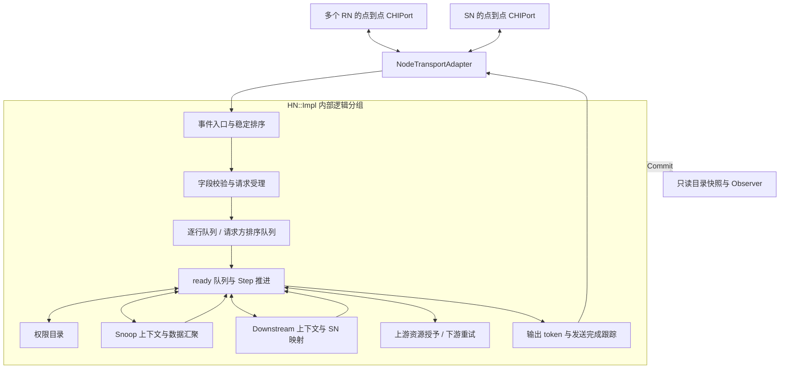
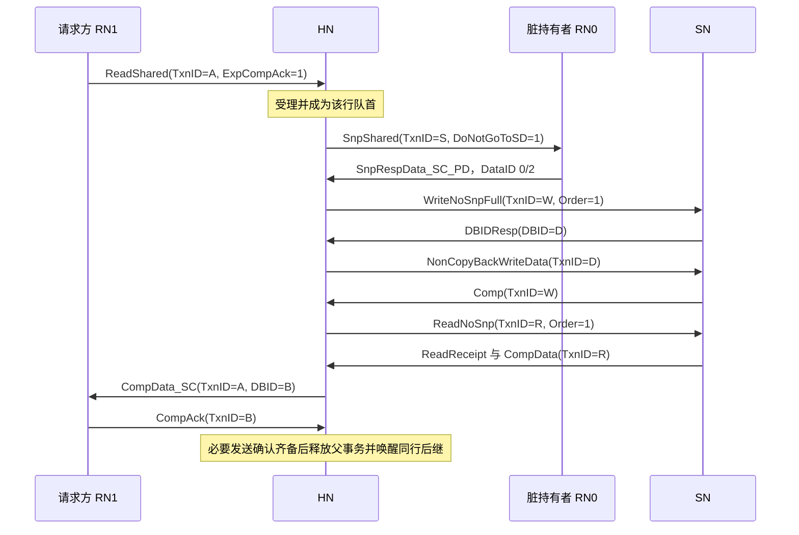

# HN 架构说明

本文对应当前 `esl::chi_vip::HN` 实现，描述 G.b `GbCore` 子集中的主动 HN-F。
整体接线见 [系统说明](../SYSTEM.md)，相邻组件见 [RN](../rn/ARCHITECTURE.md)
和 [SN](../sn/ARCHITECTURE.md)。规范依据为仓库内
[IHI0050G.b](../../../doc/IHI0050G_b_amba_chi_architecture_spec.pdf)，主要涉及
B2 标识、排序和重试，B4 一致性与竞争，B5 事务流及 B13 字段。

## 1. 职责与边界

HN 是多个 RN 之间的一致性串行化点：受理上游请求、查询目录、发出 snoop、
汇聚最新数据、访问 SN，最后向请求方返回数据或完成。HN 不提供本地 Load/Store，
不读取 RN 的缓存，也不通过函数调用修改 SN 内存；节点间交互全部经过 CHI 消息。

当前实现没有 LLC。持久保存的是目录权限，数据只保存在尚未结束的事务上下文中。
当 snoop 把脏数据责任交给 HN 时，HN 在授予清洁数据或完成相应维护操作前将其
写入 SN。这是本实现选择的保守策略，会增加下游流量，不是 CHI 唯一允许的策略。

HN 支持 20 种上游主动请求；下游只生成 ReadNoSnp、WriteNoSnpFull/Ptl 及
PCrdReturn。数据经 HN 汇聚，不启用直接数据传输、转发 snoop、Atomic、Exclusive、
DVM、Stash、持久化及分离读响应。当前协议功能不代表完整 G.b 或引脚级覆盖。

## 2. 模块和源码

图中大多数框是 `HN::Impl` 内的函数、结构和容器，当前没有独立的 DirectoryEngine
或 SnoopEngine 类。外部 API 通过 PImpl 隐藏这些实现细节。

当前 [System](../system/include/system.hpp) 固定实例化一个 HNModel，并根据 RN 数量
扩展上游点到点端口；下游连接一个 SNModel。拓扑装配、负载和结果输出不进入 HN 核心。

| 文件 | 实际内容 |
|---|---|
| [include/hn.hpp](include/hn.hpp) | HNConfig、DirectoryEntry、HN 公共接口 |
| [src/hn.cpp](src/hn.cpp) | Policy 表、组包、上下文、目录、调度、重试和完成处理 |
| [公共类型](../include/types.hpp) | Event、SendAction、Flit、Observer、错误和数据类型 |
| [共享规则](../src/rules.cpp) | opcode 属性和请求字段约束；HN 不调用 RN 的事务引擎 |
| [运输适配](../src/node_transport_adapter.cpp) | 多端口路由、四通道队列、入队与实际发送通知 |
| [平台包装](../src/system_esl_adapter.cpp) | HNModel、端口创建及 ModelBase 生命周期 |

## 3. 数据结构与标识

| 结构或容器 | 保存的内容及用途 |
|---|---|
| `Context` | 原请求、逻辑 Handle、上游 DBID、行地址、超时、独立进度标志、临时数据 |
| `requests[(SrcID, TxnID)]` | 将上游线上请求映射到逻辑 Handle，区分不同 RN 的相同 TxnID |
| `buffers[(RN, DBID)]` | 将上游写 DAT 或 CompAck 映射回原事务 |
| `line_queue[line]` | 每行的受理顺序；只有队首能进入事务处理 |
| `order_queue[RN]` | 有序请求的保守发送门槛；前一有序事务完成才推进下一项 |
| `DirectoryEntry` | `owner` 与 `sharers`，只表示协议可观察的权限 |
| `Snoop` / `snoops` | 独立 snoop TxnID、目标 RN、父事务、实际发送状态和返回数据 |
| `Downstream` / `downstream` | 独立下游 TxnID、父事务、读/回写/写入目的、SN 响应及重试状态 |
| `Assembly` | DataID 拍集合、64B 数据、有效与错误字节、首拍一致性信息 |
| `Output` / `outputs` | 唯一 token、归属事务、输出类别及 TX 是否受理 |
| `ready` / `ready_set` | 被事件唤醒的事务及去重集合；不轮询全部 outstanding |
| `timers` / `credit_timers` | 按到期时间组织的诊断期限，不用于伪造完成 |

三个 ID 池分别管理上游 DBID、下游 TxnID、snoop TxnID，池内均为 0..4095。
逻辑 Handle 和发送 token 单调分配，不能拿某条链路的 TxnID 直接当作另一条链路的
关联标识。每个父事务同一时刻至多有一个下游事务；脏数据回写和后续读取可以依次
使用不同的下游 TxnID。

`Context` 不以单个大状态枚举表达全流程。`pending_snoops`、`write_done`、
`flush_done`、`read_done`、`response`、`ack` 和 `in_flight` 分别描述不同条件，
`Step()` 只执行尚未触发且前置条件齐备的动作。

## 4. 目录与最新数据责任

`owner` 不是“该 RN 当前为 UC”的断言。RN 可以在持有唯一权限后本地写入，HN
不会收到 UC→UD 通知。因此，另一个请求需要最新数据时，HN 对潜在持有者发 snoop，
不能仅根据目录和 SN 的存储值回答请求。

`SetPermission()` 用 snoop 返回状态及即将授予的权限更新目录，检查唯一持有者
与其它共享者不能同时存在。目录在 Work 中更新工作视图，`Commit()` 发布已变化
行的只读快照。即使授予权限的目录项已发布，对该行的后继事务仍受行队列和
CompAck/写数据完成条件约束；诊断快照发布不等同于请求方已经收到完成。

数据保存在 `latest`、`latest_valid`、`latest_errors` 和 `flush_mask`：

- 完整脏数据可形成整行写回；部分脏数据只设置对应的有效字节和回写掩码。
- PassDirty 数据在父事务结束前写入 SN；未覆盖字节由 SN 的字节写使能保留。
- ReadOnce 的 SnpOnce 可以保留 RN 的脏数据责任，也可以通过合法响应转交责任。
  保留责任时，返回的快照覆盖 SN 读取值；转交责任时先执行回写。
- 请求方自己已持有的脏字节通常不通过 snoop 取回。ReadUnique 等操作完成后，
  RN 自己负责按照已有状态保留或合并其最新字节。
- MakeInvalid/MakeUnique 可以按操作语义有意丢弃旧数据，与清洁回写路径分开处理。

## 5. opcode 如何选择处理流程

`policies[]` 显式列出每个上游 opcode 的 snoop 选择、是否包含请求方以及稳定规则
编号；`Traits()` 提供读、普通写、CopyBack、无数据四个家族属性。扩展请求不能
依赖默认成功分支，必须补齐策略、校验和测试。

| 上游请求 | 对目录持有者的 snoop 策略 | 后续处理 |
|---|---|---|
| ReadNoSnp | 无 | 读取 SN，按请求窗口返回 |
| ReadOnce | SnpOnce，排除请求方 | SN 数据与返回快照合并，不分配请求方缓存权限 |
| ReadShared / ReadClean / ReadNotSharedDirty | 分别使用对应 snoop，排除请求方 | 转交的脏数据先写回，再读 SN，返回 SC 或 UC |
| ReadUnique | SnpUnique，排除请求方 | 失效其它副本、必要回写，再返回唯一权限的数据 |
| WriteNoSnpFull/Ptl | 无 | 接收上游数据，以 BE 写入 SN |
| WriteUniqueFull/Ptl | SnpUnique，排除请求方 | 其它副本失效，将旧脏字节与新写入合并送往 SN |
| WriteBackFull/Ptl、WriteCleanFull、WriteEvictFull | 无额外 snoop | 请求 CopyBack 数据，根据实际响应状态更新目录并回写 |
| CleanUnique | SnpUnique，排除请求方 | 必要回写，返回 Comp_UC，等待 CompAck |
| MakeUnique | SnpMakeInvalid，排除请求方 | 失效其它副本，返回 Comp_UC，完整替换由 RN 实施 |
| Evict | 无 | 移除请求方目录记录，返回 Comp_I |
| CleanShared | SnpCleanShared，包括请求方 | 清洁潜在持有者并完成必要回写 |
| CleanInvalid / MakeInvalid | 对应失效 snoop，排除请求方 | 清除请求方记录，分别执行清洁失效或丢弃失效 |

发出的 snoop 设置 `DoNotGoToSD=1`、`RetToSrc=0`，返回形式按 opcode 单独校验。
该属性不把 SnpOnce 的合法响应集合简化为“一律不允许 SD/PassDirty”。上游
ReadShared 类请求在没有其它持有者时返回 UC，有其它持有者时返回 SC。

## 6. 典型读流程：RN1 读取 RN0 的脏行

以下示例选择 ReadShared 和当前 RN 的预期 snoop 转换。

这里 A、S、W、R、B、D 属于不同标识用途，不能按数值相等进行关联。
SN 返回的 ReadReceipt 和数据可跨通道交错，HN 等待两者齐备。

## 7. 写入、CopyBack 与完成条件

普通写先等待必要 snoop 结束，再发 DBIDResp。只有该响应实际发送后，HN 才接受
匹配 DBID 的 NonCopyBackWriteData。数据齐备且存在待写有效字节时执行 SN 写入，
收到 SN 完成且下游 DAT 已实际发出，再向 RN 返回 Comp。`flush_mask=0` 时跳过
下游写入，例如没有 snoop 脏数据需要保留的全零 BE WriteNoSnpPtl。

CopyBack 使用 CompDBIDResp 同时给出完成和数据缓冲标识。RN 可以在发完
CopyBackWriteData 后结束自己的请求，但 HN 仍保留父事务和行队列占用，直到
必要的 SN 写入完成。因此，RN 完成、HN 完成和 SN 内存提交不是同一事件。
当前 HN 始终索取 CopyBack 数据，不使用 CAH 优化下的仅 Comp 路径。

HN 依据收到 DAT 时的响应状态处理 CopyBack，不能依赖原请求发起时的 RN 状态。
例如等待 CompDBIDResp 期间被其它事务 snoop 失效的 RN，可以返回 I 和零 BE；
HN 不应把这些无效字节当作新的内存数据。WriteCleanFull 保留相应清洁权限，
其它 CopyBack 请求移除请求方的目录权限。

| 资源 | 回收点 |
|---|---|
| 上游请求槽、DBID、请求映射 | `Finish()`：子操作结束、所需 CompAck 到达、所有本事务输出实际发送 |
| 行队列占用 | 与父事务 Finish 同步，随后显式唤醒下一项 |
| snoop ID / 上下文 | 单个完整 SnpResp 或全部 snoop DAT 到达并校验后 |
| 下游 SN DBID 占用记录 | HN 已实际发完所需写 DAT；可以早于 SN 的 Comp |
| 下游 TxnID / 上下文 | 读的数据与 ReadReceipt，或写的 Comp 与 DAT 实际发送条件均满足 |
| 输出 token | TX 受理后收到一次实际发送通知 |

HN 对每个已受理父事务都分配 DBID，即使某种无数据请求不需要把它用于 CompAck。
该分配及回收策略比按各流程最早时刻回收更保守。

## 8. 事件、排序和重试

`OnEvent()` 仅收集输入，必须在 BeginCycle/Commit 区间之外调用。
`BeginCycle()` 按 TX 受理、实际发送、RSP、DAT、REQ 的次序稳定处理本周期输入，
随后只推进 ready 队列中的事务。snoop 收齐、下游完成、发送完成和队首释放都会
显式唤醒相应父事务；行阻塞不阻断其它事务的响应接收。

所有已受理请求进入逐行 FIFO。有序请求还进入按 RN 区分的 `order_queue`，
采用整个前驱事务完成后放行的保守策略，没有在 HN 内细分本地 stream 或 endpoint。
因此不同地址通常并发，但同一 RN 的有序请求会额外串行。

HN 生成的下游 ReadNoSnp/WriteNoSnp 访存请求均为 64B 行对齐访问，使用
`Order=1`（Request Accepted），
ReturnNID=HN、ReturnTxnID=下游 TxnID、ExpCompAck=0。上游的窄访问窗口由 HN
在返回数据或合并写字节时保持；PCrdReturn 不使用这些访存字段。该下游策略针对
当前字节存储后端，不描述设备副作用。

上游容量不足时，请求进入公平的重试等待队列。HN 使用 Type 1 protocol credit：
生成 Grant 时预留槽位，Grant 实际发送后才增加可消费 credit。AllowRetry=0 请求
或 PCrdReturn 只能消耗相应 RN 的已授予 credit，不绑定原请求 TxnID。
`grant_before_retry` 控制两个响应的输出次序；本实现不提供初始预授予 credit。

HN 作为 SN 的请求方维护另一套 credit 和 FIFO 重试队列，可以先收到 PCrdGrant
再收到 RetryAck。重发保留父事务及下游 TxnID，设置 AllowRetry=0；拒绝已 Retry
请求在重发实际发送前收到的旧完成响应。所有父事务结束后归还未使用的下游 credit。

运输层按 NodeID 稳定遍历端口，四通道各自排队。Work 推进端口并处理核心，Xfer
推进实际发送并 Commit；TX 受理和实际发送确认在下一周期交给核心。所有节点须
先完成 Work，再执行任一节点的 Xfer。

## 9. 接口、配置和诊断

| API | 契约 |
|---|---|
| `HN(config, observer)` / `Config()` | 启动配置及只读查询；不依赖 ModelBase |
| `OnEvent` / `BeginCycle` / `TakeActions` / `Commit` | 输入收集、状态推进、动作移交、快照发布 |
| `InspectDirectory(address)` | 返回最近 Commit 的权限记录；不能据此判断数据是否脏 |
| `IsIdle()` | 事务、子事务、事件、输出和 protocol credit 等全部排空；允许目录仍有记录 |
| `DescribeState()` | 报告行地址、opcode、待回 snoop、写数据、CompAck 等等待状态 |
| `HNModel::Core()` / `Port(peer)` | 接入现有平台，按 NodeID 获取真实点到点端口 |

默认 NodeID=1、SN=3、RN={0,2}、内存范围 1 MiB、事务槽 16、诊断期限
10000 周期。当前 NodeID 限于 7 bit；事务槽不超过 1024，事务槽乘 RN 数量不超过
4096，以保证 snoop ID 资源。诊断期限不是 CHI 规定的固定完成期限，超时抛出
`Timeout` 并保留故障信息，不自动合成 Comp。

Observer 在 Commit 提供 `rx`、`tx_accepted`、`tx_sent`、`rule`、`complete`
记录，实际发送记录保留原 Xfer 周期。检查标识、重复拍、非法状态、提前响应、
保留 opcode 和未支持扩展时，分别报告相应诊断；这些检查是主动节点的防御检查，
不能替代完整的独立协议监视器。

## 10. 验证索引与维护入口

| 测试 | 与本架构对应的检查 |
|---|---|
| [HN 独立事件测试](../../../tests/chi_vip_hn_test.cpp) | 上/下游标识、目录快照、提前数据/CompAck/credit、Retry 后晚响应、SnpOnce PassDirty、部分合并、非法状态和超时 |
| [真实系统测试](../../../tests/chi_vip_system_test.cpp) | 20 opcode、多 RN 一致性、脏字节、重试、背压、错误传播、独立传输审计和字节参考 |
| [平台系统测试](../../../tests/chi_vip_system_platform_test.cpp) | HNModel 与真实 RNModel/SNModel 接线、正反 Work/Xfer 遍历一致性 |

维护新的 opcode 时，应一起核对 `policies[]`、共享请求属性/字段约束、`Step()`
前置条件、SnoopDone 响应集合和独立测试。修改资源回收点时，必须检查“实际发送”
与“动作生成”的区别，以及下一个同行事务是否会过早发出 snoop。
