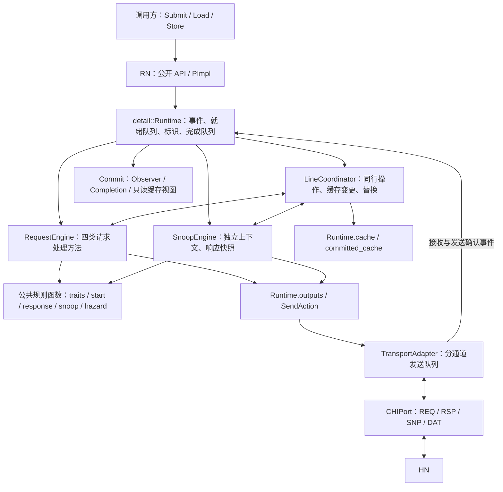
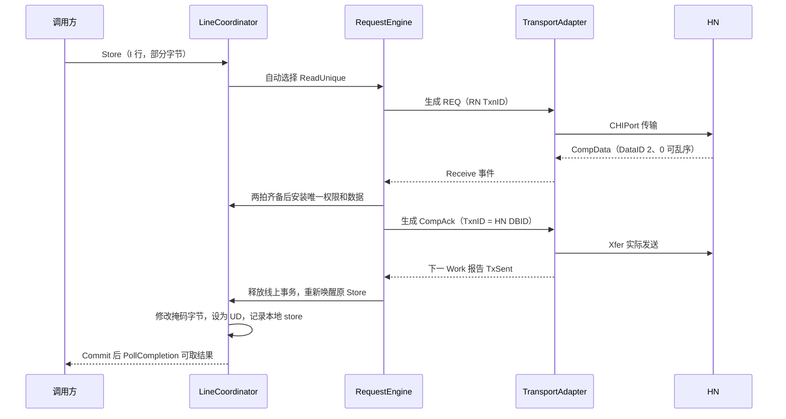

# RN-F 组件架构说明

本文对照当前 `esl::chi_vip::RN` 实现，说明请求、缓存和 snoop 如何协作。
协议依据为 [CHI G.b](../../../doc/IHI0050G_b_amba_chi_architecture_spec.pdf) 的 B2、B4、B9、B13；事务流背景见 B5。
范围是 `GbCore` 指定事务集合的协议层 RN-F，功能策略不等于协议允许行为的全集。
三节点接线见 [系统说明](../SYSTEM.md)，配套组件见 [HN 架构](../hn/ARCHITECTURE.md) 和 [SN 架构](../sn/ARCHITECTURE.md)。

## 1. 职责与模块边界

RN 接受精确协议请求及本地 Load/Store，维护功能缓存，响应来自一个配置 HN 的 snoop。
它只通过 CHI flit 与其他节点交换信息，不读取 HN/SN 的内部状态。
默认是单线程、Non-secure、64B 缓存行和 256-bit DAT，数据经 HN 返回。

图中 `RN`、`Runtime`、`LineCoordinator`、`RequestEngine`、`SnoopEngine` 和 `TransportAdapter` 是实际类型。
“规则”“缓存”“输出”是函数或数据结构分组；没有额外的 Cache、调度器或四个请求处理器类。
`RNModel` 位于外层，将 `RN + CHIPort + TransportAdapter` 封装为现有 `ModelBase`。
当前应用由 [System](../system/include/system.hpp) 实例化多个 RNModel，通过 Load/Store
驱动本组件；最终清理通过 Submit 发起 WriteBack/Evict，不直接修改缓存状态。

| 源码 | 主要维护内容 |
| --- | --- |
| [include/rn.hpp](include/rn.hpp) | 公开接口、周期契约与只读诊断 |
| [src/rn_internal.hpp](src/rn_internal.hpp) | 上下文、队列、三个内部协作类 |
| [src/rn.cpp](src/rn.cpp) | 输入受理、事件调度、行协调、缓存、Commit |
| [src/request_engine.cpp](src/request_engine.cpp) | 请求发出、响应、四类完成路径、credit |
| [src/snoop_engine.cpp](src/snoop_engine.cpp) | snoop 校验、竞争判定、响应快照和释放 |
| [公共 types](../include/types.hpp)、[types.cpp](../src/types.cpp) | 配置、flit 变体、数据掩码、错误及观测记录 |
| [公共 rules](../include/rules.hpp)、[rules.cpp](../src/rules.cpp) | 能力集合和 opcode/state/phase 规则 |
| [transport_adapter.cpp](../src/transport_adapter.cpp) | RN 单个点到点端口的周期适配 |
| [esl_adapter.hpp](../include/esl_adapter.hpp)、[esl_adapter.cpp](../src/esl_adapter.cpp) | `RNModel` 生命周期封装 |

RN 专属核心在 `rn/`；共用类型、规则和适配器仍在 `chi_vip/include`、`chi_vip/src`。
构建分为 `esl_chi_vip`、`esl_chi_vip_transport`、`esl_chi_vip_adapter`，前者不依赖 ModelBase、日志或配置解析器。

## 2. 数据结构、队列和状态

| 结构 | 内容与生命周期 |
| --- | --- |
| `Job` | 一次 Submit/Load/Store 或内部替换；逻辑 Handle、行地址、访问掩码及是否正在走线 |
| `RequestContext` | 一次线上协议阶段；REQ、代次、接收拍、数据/error 掩码、DBID、响应事实和发送计数 |
| `SnoopContext` | 一次 HN snoop；请求、行地址、回填等待、响应是否生成及未发送 flit 数 |
| `CacheLine` | 状态、64B 数据、`valid`、`dirty`、`errors`、LRU 序号和 CAH |
| `Output` | 唯一 Token、不可变 SendAction、所属引擎/上下文、代次、入队确认标志 |

`Job` 和 `RequestContext` 不是一一终身绑定：自动 Load/Store 可在一个逻辑操作内依次发出多个协议事务。
例如 UDP 的缺失字节 Load 先 WriteBackPtl，再 ReadShared，最后执行本地命中读取。

| Runtime 成员 | 用途 |
| --- | --- |
| `line_jobs` | 每行主动操作 FIFO；只有队首可以推进，跨行可同时占用请求槽 |
| `line_snoops`、`snoop_ids` | 正在处理的 snoop 及 `(SrcID, TxnID)` 去重；重复同行未完成 snoop 被拒绝 |
| `ready_jobs/requests/snoops` 与配套 set | 待运行队列和去重，优先推进 snoop，再请求，再本地操作 |
| `resource_waiters` | 缺少槽位或缓存位置的操作；释放资源时唤醒 |
| `events` | 外部接收、TX 受理及 TX 实际发送确认 |
| `outputs`、`actions` | 全部尚未确认发送的输出，以及本轮待交付给适配器的输出 |
| `timers`、`snoop_timers` | 按到期时间排序的诊断堆；已完成上下文的过期项惰性移除 |
| `ordered`、`credits/credit_waiters` | 顺序门槛及按授予节点和类型分类的协议 credit |

运行时不逐周期扫描全部 outstanding。缓存满时选 LRU 会遍历缓存条目；资源释放会唤醒资源等待者。
缓存是按行地址存放的全相联功能模型，LRU 排除有本地操作或未完成 snoop 的行。

七种状态为 I、SC、UC、UD、SD、UCE、UDP。UCE 表示唯一权限但无有效数据，UDP 表示部分有效的唯一脏行。
`dirty` 表示脏数据责任，不能仅用状态名或“曾写过”替代；`errors` 标记可见数据错误字节。
所有正常缓存变化经 `LineCoordinator::Put/Invalidate`；`Put` 检查 I 行无有效/脏字节、脏与错误掩码不越过有效字节等不变量。

## 3. opcode 与状态规则如何维护

规则位于公共 `rules.cpp`，引擎负责按结果执行动作，不在每个 opcode 分支复制完整流程。
`RequestRule` 保存 `OpcodeTraits` 和合法起始状态位图；`SnoopRule` 是 8 × 7 显式矩阵。
请求起始状态在操作成为同行队首时校验，反映排队期间可能发生的 snoop 变化。

| 类别/请求 | 合法起始缓存状态 |
| --- | --- |
| ReadNoSnp、ReadOnce | I |
| ReadShared、ReadClean、ReadNotSharedDirty | I、UCE |
| ReadUnique | 全部七种 |
| WriteNoSnpFull/Ptl、WriteUniqueFull/Ptl | I |
| WriteBackFull、WriteCleanFull | UD、SD |
| WriteBackPtl | UDP |
| WriteEvictFull | UC |
| CleanUnique | I、SC、UC、UD、SD、UCE |
| MakeUnique | I、SC、UC、SD、UCE |
| Evict、CleanInvalid | I、SC、UC、UCE |
| CleanShared | I、SC、UC |
| MakeInvalid | 全部七种 |

规则分五类：opcode 属性、请求起始、响应结果、snoop 转换、竞争处理。
`ReadResult` 校验 CompData 的 Resp 并推导缓存状态；`DecideSnoop` 返回下一状态、是否传数据、是否部分数据及 PassDirty。
`RetToSrc` 和 `DoNotGoToSD` 在 snoop 矩阵之上修正合法策略；不适用字段仍被校验。
`DecideHazard` 根据请求阶段和是否分配缓存返回“处理、等回填、违规”，没有默认成功项。

`RuleCatalog` 目前登记 121 条稳定规则：20 opcode、20 起始、20 响应、56 snoop 单元、5 竞争规则。
编号如 `RN.START.<opcode>`、`RN.SNP.<opcode>.<state>`，携带 B4/B13 等出处并进入 Observer。
`ValidateRuleTables` 在 RN 构造时检查重复、能力集合缺项、矩阵取值和规则分类数量。
目录覆盖的是这些规则族；字段校验、超时和所有内部不变量并非每项都单独登记为 catalog 规则。

扩展时同步维护能力列表、请求/转换表、响应校验、引擎完成条件和独立测试预期；禁止只给 opcode 添加成功分支。
合法但未启用的扩展报告 `kUnsupportedFeature`，保留编码或不合法的线上行为报告 `kProtocolViolation`。

## 4. 请求引擎：事实驱动的四类处理

`RequestContext` 的 `req_sent/comp/dbid_received/receipt/applied/terminal_issued/in_flight` 是独立事实。
`Step` 根据事实选择四个私有处理方法；不是只有一个“等待响应”状态的线性状态机。

| 方法 | 推进和完成条件 |
| --- | --- |
| `Read` | 按 DataID 组包；要求所需拍齐备后一次安装；按需生成 CompAck；有序非分配读还须收到 ReadReceipt |
| `ImmediateWrite` | DBID 一到即可生成 NonCopyBackWriteData；Comp 可先后独立到达；最后等待 Comp 与所有 DAT 实际发送 |
| `CopyBack` | 收到合法完成形式并等同行 snoop 结束；重新读取当前缓存快照；发送 CopyBackWriteData 或 CAH 允许的 CompAck |
| `Dataless` | Comp 后按当前行状态执行 CleanUnique/MakeUnique 等处理；按需发送 CompAck |

Read 接收支持两拍乱序，检查重复 DataID、CCID、跨拍 Resp/CAH/错误类型一致性，CompData 的 BE 不作为读有效掩码。
ReadUnique 遇到已有脏数据时保留本地有效字节，UDP 的其他字节由回填补齐；已有干净数据与返回数据矛盾会报错。
NDERR 不建立新缓存权限或恢复已被 snoop 失效的数据；DERR 保存在字节错误掩码并向本地读取/转发传播。

普通写支持 CompDBIDResp，以及 Comp 和 DBIDResp/DBIDRespOrd 两种先后顺序，检查同一来源的 DBID 一致。
CopyBack 必须按响应时的缓存状态取快照：若等待期间被失效，仍发规定拍数，但数据和 BE 都为零。
WriteCleanFull 清除脏责任并保留干净副本，WriteBack/WriteEvict 路径失效本地行。
Evict、CleanInvalid、MakeInvalid 发 REQ 前做本地失效；显式 MakeUnique 要求完整整行替换数据。

图中“实际发送确认”由运输层产生，不是 HN 发出的额外 CHI 消息。

## 5. Snoop 引擎与行竞争

Snoop 使用独立上下文和容量，普通请求槽耗尽不影响其接收和响应。
支持 SnpOnce、SnpShared、SnpClean、SnpNotSharedDirty、SnpUnique、SnpCleanShared、SnpCleanInvalid、SnpMakeInvalid。
线上 SNP 地址解码为 `flit_address << 3`；源必须是配置 HN，目标由连接关系确定，未给 `CHISnpFlit` 增加非标准 TgtID。

| 同行竞争阶段 | 当前处理 |
| --- | --- |
| 主动请求尚未收到响应 | snoop 正常处理，主动请求保留上下文 |
| 读只收到部分 DAT | 保留 snoop 上下文；回填齐备唤醒后处理 |
| 分配读已回填、终结发送未结束 | 后来的 snoop 报违规，要求 HN 遵守 CompAck 屏障 |
| 非分配读已取得数据、仍待有序受理等条件 | 可以处理 snoop |
| snoopable 写已生成终结发送 | 后来的 snoop 报违规，保护响应/写数据时序 |
| CopyBack 等待响应时先被 snoop | 先响应 snoop，再基于最新缓存状态生成 CopyBack 数据 |

这些约束依据 B4.11 与 B2.6；SnoopEngine 拒绝上一个同行 snoop 尚未实际发完时到来的第二个 snoop。
Snoop 命中后先复制缓存快照，产生一个 SnpResp 或两拍 SnpRespData/Ptl，再更新本地状态。
生成的输出不会被后续 Store 修改。局部操作仍等所有响应拍实际发送后才继续。
Snoop 完成释放 `(SrcID, TxnID)` 和上下文，唤醒同行请求、本地操作及资源等待者。

LineCoordinator 的同行 FIFO 只串行化主动操作；它不拿一个行忙标志阻塞 snoop。
所有已返回数据拍仍能被接收，回填完成会显式唤醒等待该行的 snoop。
CleanUnique 处理 Comp 时查看现态；若先被失效，只得到 UCE，不复活旧数据。

## 6. 自动访存、替换与资源

Load 在有效字节覆盖访问掩码时本地完成，并只报告该掩码内的数据错误。
普通缺失选择 ReadShared；UDP 缺失先写回部分脏数据，再读取完整行。
Store 已有唯一权限时局部修改；I 行选 ReadUnique，共享行选 CleanUnique，取得权限后重新执行原操作。
有效字节齐全则为 UD，否则为 UDP；被覆盖字节清除错误标记，本地写入清除 CAH 并进入 Observer。

缓存需要位置时选择没有活动操作的最旧行：I 直接复用，UDP 发 WriteBackPtl，其他脏行发 WriteBackFull，干净行发 Evict。
内部替换使用保留维护槽，结束后移除受害行并唤醒等待者；当前实现只有一个维护槽。
没有受害候选或请求槽不足时进入资源等待队列，不抛协议异常。
外部待处理操作达到 `pending_operations` 后，Submit/Load/Store 返回 `accepted=false`。

## 7. 周期、发送确认、标识和排序

外部 `Submit/Load/Store/OnEvent` 只允许在 Commit 与下一次 BeginCycle 之间调用。
Work 依次推进端口、收集上周期确认与入站 RSP/SNP/DAT、执行 BeginCycle、取得动作并尝试端口入队。
Xfer 推进端口实际发送，通过 `Transmitted<T>()` 关联 Token，调用 Commit；确认事件在下一 Work 交给核心。
同周期事件稳定排序为 TX Accepted、TX Sent、RSP、SNP、DAT；每组保留输入先后。
所有节点先 Work 再 Xfer，跨节点消息最早下一周期可见；注册遍历顺序不应改变结果。

`cache` 是本周期工作状态，`committed_cache` 是 InspectLine 看到的发布状态。
Commit 发布被修改的缓存条目、完成队列及 Observer 记录；不是对整个 Runtime 做事务回滚或全量复制。
四个通道各有适配层发送队列，REQ 背压不在软件队列头阻塞 RSP/DAT。
SNP 槽满时适配器暂停消费 SNP RX 队列，其他响应通道仍可推进。

| 标识/资源 | 关联与释放条件 |
| --- | --- |
| 逻辑 `Handle` | 外部操作全程保持；内部替换独立分配；不能与 snoop 的内部编号混作全局唯一键 |
| RN `TxnID` | 4096 项池和 `txn_map`；线上事务满足完成条件且终结输出已实际发完才回收 |
| HN `DBID` | `remote_buffers[(HN, DBID)]` 检查重复占用；相关 DAT/CompAck 全部实际发送后释放，可能早于迟到的 Comp |
| 输出 `Token` | 全 RN 唯一；Accepted 只表示本地入队，Sent 才减少 `in_flight` 并触发回收 |
| 请求槽/行队首 | 线上阶段结束释放请求槽；整个逻辑操作结束才移除行队首 |
| snoop 槽 | 所有 snoop 响应 flit 实际发完才释放 |

初次 REQ 使用 AllowRetry=1；RetryAck 将上下文放入 `(HN, PCrdType)` FIFO 等待。
PCrdGrant 独立记账，因此可以早于 RetryAck，不能按它的 TxnID 绑定某次请求。
重发消耗 credit，保持逻辑操作和线上 TxnID、增加内部 generation，使用 AllowRetry=0；再次 RetryAck 报违规。
没有 Job 时产生 PCrdReturn 归还闲置 credit。Link credit 由 CHIPort 管理。

有序操作按 `(本地 stream_id, address / endpoint_size)` 排队；`stream_id` 不映射可选线上 StreamID。
有序非分配读以 ReadReceipt、普通写以 DBID 响应释放发送门槛，重试不越过前驱。
同行操作还受完整生命周期 FIFO 约束，因此有意比最小 Request Order 要求更保守。
Normal memory 支持 Order 0/2；Endpoint Order=3 只用于显式 Device-nRnE 非一致性访问，RN→HN 的 Order=1 拒绝。

## 8. API、配置与观测

| API | 接入契约 |
| --- | --- |
| `Submit(TxnRequest)` | 精确 opcode；Size 为 1..64 的二次幂，并受 opcode 约束；data/BE 为行内字节位置 |
| `Load(address, size)` | 1..64B，必须落在同一行；自动选取协议路径 |
| `Store(address, data, byte_enable)` | mask 非零且以行内字节编号，address 选择缓存行；自动获取唯一权限 |
| `OnEvent/BeginCycle/TakeActions/Commit` | 核心输入、一次周期计算、输出移交与结果发布 |
| `PollCompletion/InspectLine` | 消费完成结果、读取已提交缓存快照 |
| `IsIdle/DescribeState/Config` | 排空、等待原因和配置查询 |

默认配置为 node_id=0、home_id=1、NodeID 7 位、地址 48 位、内存范围 1MiB、endpoint 4KiB。
资源默认 cache_lines=64、request_slots=16、maintenance_slots=1、snoop_slots=8、pending_operations=64。
`maintenance_slots` 目前必须等于 1；request_slots 上限 1023，为维护事务保留一个 outstanding 名额。
默认诊断超时 10000 周期，设为 0 关闭；超时报告活跃操作，不伪造完成也不自动取消事务。

Observer 在 Commit 接收只读记录：rx、tx_accepted、tx_sent、rule、cache、store、complete。
tx_sent 带实际 Xfer 周期；局部写入含数据和掩码，供外部数据检查器建立最新值模型。
访问 DERR/NDERR 经 Completion 返回；配置、非法请求、协议违规、生命周期和诊断超时使用分类 VIPError。
IsIdle 要求操作、snoop、输入、输出、credit、DBID 及完成队列排空；调用方必须消费 PollCompletion。
IsIdle 允许缓存仍持有干净或脏数据，不表示已将缓存全部写回内存；适配层还检查端口与发送队列排空。

## 9. 独立测试索引与边界

| CTest / 源码入口 | 主要验证内容 |
| --- | --- |
| `chi_vip_requests` / [Requests](../../../tests/chi_vip_test.cpp) | 20 opcode × 起始状态、响应形式、字节窗口、BE、规则命中 |
| `chi_vip_snoops` / [Snoops](../../../tests/chi_vip_test.cpp) | 8 × 7 矩阵、RetToSrc/DoNotGoToSD、数据和脏责任 |
| `chi_vip_hazards` / [Hazards](../../../tests/chi_vip_test.cpp) | 回填中 snoop、CopyBack 失效、CleanUnique 竞争、响应快照 |
| `chi_vip_retry`、`chi_vip_resources` / [Retry、Resources](../../../tests/chi_vip_test.cpp) | grant/retry 两种顺序、credit 归还、有序门槛、保留替换槽 |
| `chi_vip_negative`、`chi_vip_contract` / [负向测试](../../../tests/chi_vip_test.cpp)、[契约测试](../../../tests/chi_vip_contract_test.cpp) | 重复/未知消息、非法字段、超时、DBID 生命周期、TxnID 回绕、提交视图 |
| `chi_vip_stress`、`chi_vip_adapter` / [压力与端口测试](../../../tests/chi_vip_test.cpp) | 固定种子、数据预期、背压、Work/Xfer 反向遍历 |
| `chi_vip_platform` / [平台测试](../../../tests/chi_vip_platform_test.cpp) | RNModel、内核生命周期、正反遍历确定性 |
| `chi_vip_system_*` / [系统测试](../../../tests/chi_vip_system_test.cpp) | 真实 2 RN + HN + SN 接线、共享/唯一权限、脏数据、流控与错误传播 |

RN 测试的可编排 HN 替身和数据构造见 [测试支撑](../../../tests/chi_vip_test_support.hpp)；矩阵预期独立于主动规则表维护。
本说明是源码架构索引；本次文档编写未重新执行测试，运行方式和既有验收范围见 [README](../README.md)。

当前没有 DMT/DCT/DWT、OWO、分离读响应、Atomic、Exclusive、DVM、Stash、持久化及其他可选扩展。
仅启动复位、单线程单时钟、一条 RN→HN 链路；不存在多个 HN 的地址路由策略或在线复位恢复。
事件接口只有 Receive、TxAccepted、TxSent 三类，资源唤醒和定时诊断在 Runtime 内部实现。
规则目录和 Observer 提供可检查性，但不等于已实现一个完整 G.b 独立协议监视器，也不声明引脚级或性能模型时序覆盖。
