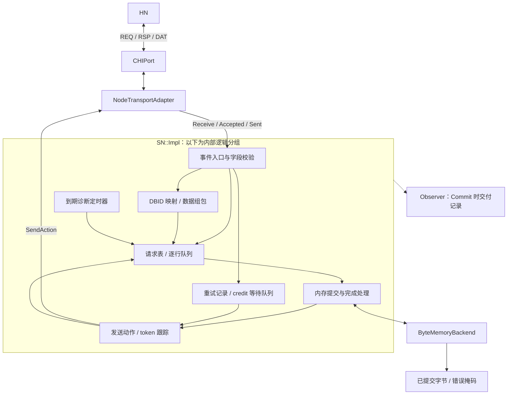
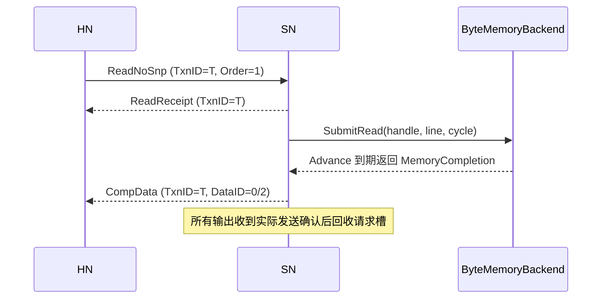
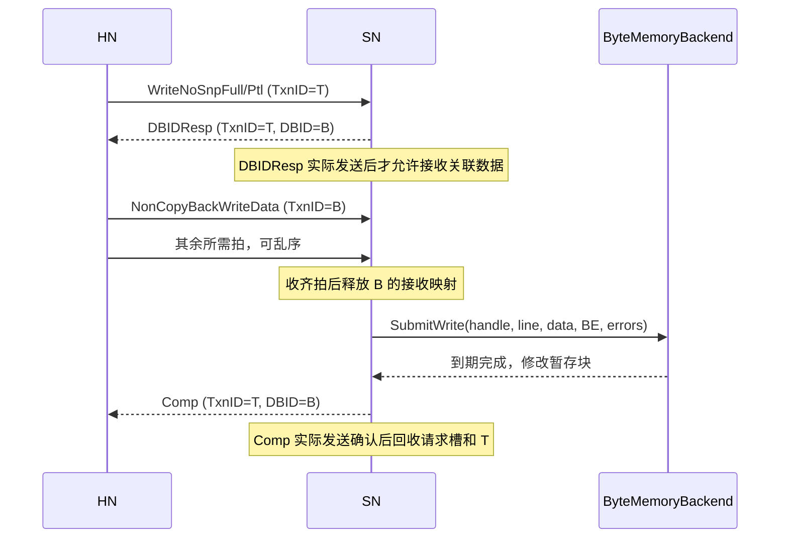

# SN-F 架构说明

本文描述 `esl::chi_vip::SN` 的当前实现。SN 是 HN 的非一致性内存服务端，
通过 CHI 接收请求和写数据，异步访问字节存储，再返回受理响应、数据或完成。
缓存一致性、目录和 snoop 由 HN/RN 负责；SN 不查询其他节点的内部状态。
系统连接示例见 [SYSTEM.md](../SYSTEM.md)，配套组件见
[RN 架构](../rn/ARCHITECTURE.md) 和 [HN 架构](../hn/ARCHITECTURE.md)。规范依据为
[CHI G.b](../../../doc/IHI0050G_b_amba_chi_architecture_spec.pdf) 的 B2、B9、B13 和 C3。

## 1. 角色与支持边界

| 输入 | 当前处理 |
|---|---|
| `ReadNoSnp` | 受理后读取所在缓存行，按访问窗口返回 `CompData` |
| `WriteNoSnpFull` | 分配写 DBID，收齐两拍完整数据后异步写入 |
| `WriteNoSnpPtl` | 按 Size/BE 接收所需数据拍，仅修改使能字节 |
| `PCrdReturn` | 归还已授予且未消费的 Type 1 protocol credit |
| `NonCopyBackWriteData` | 用 DAT.TxnID 查找 SN 分配的 DBID，组装写数据 |

节点只连接配置中的一个 HN。源/目的 NodeID 必须匹配该连接；
`ReturnNID=home_id`、`ReturnTxnID=REQ.TxnID`，读数据经 HN 返回 RN。
SN 不接收 RSP/SNP，不启用 CompAck、DMT/DWT、分离读响应或缓存分配。
`ReadShared` 等一致性 RN 请求直接到达 SN，按 C3 节点角色报告协议错误。
已识别但未启用的合法扩展报告 `UnsupportedFeature`，保留编码和非法字段
报告 `ProtocolViolation`，不会生成伪成功响应。

默认使用 64B 行、256-bit DAT、Normal memory、Non-secure 地址空间。
支持的请求 `Size` 为 0–6；Full 写必须为 6。Normal 内存要求 EWA=1，
Allocate=1 时必须 Cacheable=1。`Order=3` 的 Endpoint Order 不在此 SN 范围。
这些限制对应源码中的 B2.7、B2.8、B13 和 C3 校验。

## 2. 模块与源码

图中请求管理、组包、credit 和发送跟踪都是 `SN::Impl` 的函数和容器，
并非额外的引擎类。核心库只依赖标准库和公共 CHI 类型，运输和平台包装另行构建。

当前 [System](../system/include/system.hpp) 通过 SNModel 装配此组件，以地址和 seed
初始化内存。运行期间全部数据访问经过 CHI；最终协议清理及链路排空后，应用才通过
管理接口将 SN 存储与独立字节参考比较。

| 文件 | 作用 |
|---|---|
| [sn.hpp](include/sn.hpp) | `SNConfig`、SN 周期入口、诊断和内存管理接口 |
| [sn.cpp](src/sn.cpp) | 字段校验、事务、DBID、重试、事件和完成条件 |
| [memory_backend.hpp](include/memory_backend.hpp) | 异步后端接口和字节存储接口 |
| [memory_backend.cpp](src/memory_backend.cpp) | 到期操作队列、暂存写入和错误字节 |
| [types.hpp](../include/types.hpp) | `Event`、`SendAction`、`Flit`、`Observation` |
| [node_transport_adapter.cpp](../src/node_transport_adapter.cpp) | CHI 通道队列与实际发送确认 |
| [system_esl_adapter.hpp](../include/system_esl_adapter.hpp) | `SNModel` 与现有 ModelBase 的连接 |

## 3. 事务和资源结构

| 数据结构 | 保存内容与用途 |
|---|---|
| `Request` / `requests` | 逻辑 handle、原始 REQ、DBID、已收拍、数据/BE/错误、内存状态和未发送输出数 |
| `live_ids` | HN 线上 TxnID → 逻辑 handle，检测活跃请求标识重复 |
| `buffers` / `free_dbids` | DBID → 写请求，以及 0–4095 的空闲 DBID 池 |
| `line_queues` | 缓存行地址 → 按受理顺序排列的逻辑 handle |
| `Retry` / `retries` | 原始请求、RetryAck/Grant 是否已生成、待发送输出数 |
| `credit_waiters` | 等待资源保证的重试记录 FIFO |
| `outputs` | token → 不可变发送动作、所属事务和 TX 入队标记 |
| `timers` | 按到期周期和逻辑 handle 排序的诊断最小堆 |

SN 只有一个配置的 HN，因此 `live_ids` 以 TxnID 为键；这不是面向多个
发起节点的全局关联表。逻辑 handle 单调递增，与可复用的线上 TxnID 分离，
旧超时记录不会误命中新请求。发送 token 另行递增，用于区分每个 flit 的发送阶段。

同行只有队首能够提交内存操作。写队首未收齐数据时，同行读等待；其他行可以
提交和完成。该队列是实现选择，不是对所有 CHI 事务使用全局串行化。
前驱内存操作完成后即可启动同行后继，不必等待前驱完成响应真正发出。

## 4. 读流程与 Request Accepted

HN→SN 使用 B2.6 的 `Order=1`（Request Accepted）。SN 对非零受支持
Order 生成 `ReadReceipt`；无序读不生成。写请求使用 DBIDResp 表示受理。
Receipt 表示请求已受理，不表示内存完成；响应通道和数据通道之间不假定固定延迟。

读先取得整行快照，再按 `BeatMask(address, 1 << Size)` 选择一拍或两拍。
返回的 `SrcID` 和 `HomeNID` 为 SN，`TgtID` 为 HN，TxnID 为 ReturnTxnID，
`Resp=I`，`CCID=Address[5:4]`。读 DAT 的 BE 不承担写使能语义。
SN 不等待 CompAck；HN 上游是否需要 CompAck 属于 HN/RN 事务生命周期。

## 5. 写流程、数据窗口和错误

DAT 仅接受 DataID 0/2，分别覆盖行内低/高 32B；单拍 BE 仅使用低 32 位。
重复拍、意外拍、错误 CCID、未知 DBID 或 DBIDResp 尚未实际发送时到来的数据
均报错。B2.8 的 Normal 数据窗口按 Size 向下对齐，地址可携带关键块位置；
例如地址 39、Size=2 的窗口为字节 36–39，所需 DAT 为 DataID=2。

Full 写每拍 BE 必须为 `0xffffffff`；Partial 写允许稀疏或全零 BE。
BE 不得超出请求窗口，禁用字节的数据必须为零。即使某拍 BE 全零，只要
`BeatMask` 要求该拍，仍必须收到该拍，才能完成组包并释放 DBID。

B9 错误处理分为两类：DERR 将该拍使能字节标记为错误，仍写入数据；
后续读若某个 32B 返回拍包含错误字节，该拍返回 DERR。正常覆盖会清除对应
字节的旧错误，未覆盖字节保持原值和原错误。写 Comp 按此次写的错误返回 DERR。
NDERR 要求所有拍一致，收齐后提交零写掩码的异步操作，保留原数据和错误，
并返回 NDERR Comp。各拍 Resp 也必须一致；不支持 Exclusive 的 EXOK 编码。

## 6. 标识和实际发送生命周期

| 资源 | 建立 | 回收条件 |
|---|---|---|
| 请求 TxnID / 请求槽 | 请求获得受理资源 | 内存完成且该请求所有输出收到 `TxSent` |
| 写 DBID 接收映射 | 接受写请求、生成 DBIDResp | 收齐全部必需 DAT；无需等内存完成或 Comp 发出 |
| 同行服务队首 | 请求受理入队 | 内存完成；随后唤醒下一个同行请求 |
| 输出 token | `Emit` 生成 SendAction | 先收到 `TxAccepted`，再收到 `TxSent` |
| 被重试请求 TxnID | 建立重试记录 | RetryAck 实际发送确认 |
| 重试记录 | 请求容量不足 | RetryAck 和 PCrdGrant 均已生成且输出全部实际发送 |

因此写请求仍可保留已用过的 DBID 数值用于 Comp，而 `buffers` 中该 DBID
接收资源已经释放。请求槽持续占用至完成输出真正发送，避免把本地入队视为完成。
这些区分对应 B2.4 的标识关联与 B2.6 的完成关系；资源保留更久的部分是实现策略。

## 7. 重试和资源保证

初发请求要求 `AllowRetry=1, PCrdType=0`。容量不足或已有公平等待者时创建
重试记录，进入 FIFO；最多保存 1024 个待重试记录。Type 固定为 1。
`grant_before_retry=false` 时先生成 RetryAck，资源可用后生成 Grant；为 true
时等待资源可用，再先生成 Grant、后生成 RetryAck，用于验证两种响应次序。

`reserved_credits` 在生成 Grant 时增加，立即从可供新请求使用的容量中扣除；
`available_credits` 仅在 Grant 实际发送确认时增加。合法重发必须为
`AllowRetry=0, PCrdType=1`，同时消费这两个计数，其保留槽保证受理，不再次重试。
Credit 归属 HN/Type，不绑定原 TxnID，重发可以使用另一个 TxnID。
PCrdReturn 消费未用 credit 并尝试唤醒下一位等待者。未消费或未归还的 credit
使 SN 保持非空闲。RetryAck/Grant 发完并删除重试记录后，存量 credit 没有独立
超时计时器，系统仍需检查排空。Link credit 独立由 CHIPort 管理。

## 8. 异步内存与周期提交

`ByteMemoryBackend` 保存字节数组、逐行错误掩码、暂存块和到期操作 FIFO。
提交周期必须单调，`due=cycle+service_latency`。固定服务延迟保证 FIFO 的
到期顺序；`Advance` 仅处理已到期队首，无需每周期扫描所有 outstanding。
同一轮 Advance 中的后续操作能读取前面写入的暂存块。

`Advance` 返回带逻辑 handle 的完成记录；写入首先进入 `staged`。
`Commit` 才发布字节和错误掩码，因此管理接口 Read/Errors 在提交前仍读取旧值。
SN 的事务表在 BeginCycle 内直接推进；不是复制整个核心后在 Commit 交换状态。
Commit 的明确职责是发布内存变化和批量交付 Observer 记录。

`OnEvent` 必须在 BeginCycle/Commit 之外调用。BeginCycle 按固定优先级稳定处理
TX 入队确认、实际发送确认、接收 DAT、其他接收事件，再处理到期内存和诊断计时器。
这使同周期的 DBID 发送确认先于关联 DAT 校验。相同优先级保持入队顺序。
每周期须 TakeActions 清空已生成动作，再 Commit；周期号必须严格递增。

适配器 Work 推进端口、交付上一周期发送确认、收取 flit，随后调用 BeginCycle
并尝试分通道发送。Xfer 记录 CHIPort 的实际发送结果并调用 Commit；确认事件
在下一周期交给核心。所有节点必须先完成 Work，再执行任何节点 Xfer。
SNModel 持有 SN、一个 CHIPort 和适配器，公开 Core()/Port()，仅支持启动复位。

## 9. 接口、配置与排空

| 接口/配置 | 契约或默认值 |
|---|---|
| `SN(config, observer)` / `Config()` | 构造配置并只读查询；NodeID/home_id 默认为 3/1 |
| `OnEvent / BeginCycle / TakeActions / Commit` | 无业务 Submit 接口，协议事务由收到的 REQ 启动 |
| `Memory().Initialize(address, line, mask)` | 内存空闲时初始化整行地址的指定字节，同时清除对应错误 |
| `Memory().Read(address, size)` / `Errors(line)` | 只读已提交内容；Read 返回行内位置的字节，不跨行 |
| `memory_size / service_latency` | 1 MiB / 5 周期；存储大小必须为 64B 的倍数 |
| `request_slots / grant_before_retry` | 16 / false；事务槽范围 1–1024 |
| `timeout_cycles` | 10000；0 关闭诊断，超时不会伪造协议完成 |

初始化应在系统启动前执行；最终数据检查应在系统排空且 RN 脏数据已按协议清洁后执行。
后端 Initialize 只检查内存后端空闲，不代表整个 SN 或系统已经空闲。
`MemoryBackend` 已定义抽象服务接口，但 SN 当前直接拥有 `ByteMemoryBackend`，
构造函数尚不接受外部后端注入，不能据此宣称支持任意内存实现。

`IsIdle` 检查事务、重试、输出、事件、动作、DBID 映射、逐行队列、credit 等待者、
credit 计数和内存操作/暂存写入。适配器再检查链路、通道队列及未交付的确认。
`DescribeState` 输出 active/retry/DBID/pending_tx/reserved_credit/available_credit，
超时附带此状态，不自动释放资源。Observer 在 Commit 接收 rx、tx_accepted、
tx_sent、rule、complete 记录；实际发送记录保留适配器提供的发送周期。

## 10. 测试索引与验证边界

| 独立用例 | 覆盖内容 |
|---|---|
| `MemoryBackendTest` | 服务延迟、Commit 可见性、掩码写、错误持久与初始化清除 |
| `BasicTest` | ReadReceipt、读字段、Full/Ptl、乱序拍、窄窗口、关键块地址 |
| `ErrorTest` | 分拍 DERR、错误保留、NDERR 不修改内存 |
| `RetryTest` | 单槽压力、两种 Grant/Ack 次序、换 TxnID 重发和 credit 归还 |
| `OrderingTest` | 同行写数据未齐时阻止后继读，不阻塞其他行 |
| `NegativeTest` | 节点角色、扩展分类、非法字段/DBID/拍/错误编码、过早 DAT 和缺拍超时 |
| `StressTest` | 固定种子 500 次随机 BE 写入，独立字节参考和拍次序 |

源码见 [chi_vip_sn_test.cpp](../../../tests/chi_vip_sn_test.cpp)，CTest 入口为
`chi_vip_sn`。测试自行编码/解码 flit，不调用生产组包函数计算预期值。
[系统测试](../../../tests/chi_vip_system_test.cpp) 通过真实 CHIPort 连接 2 RN、HN、SN，
补充全部上游 opcode、下游重试、Request Accepted、背压、错误传播及正反遍历检查；
[平台测试](../../../tests/chi_vip_system_platform_test.cpp) 验证 ModelBase 接入。

本说明对应协议功能模型：固定延迟内存不模拟 DRAM 银行、带宽仲裁或详细时序；
SN 不承担一致性检查器职责，独立总线审计位于测试中。支持子集和实现策略应分别
理解，不把通过这些测试解释为完整 G.b 认证或引脚级覆盖。
